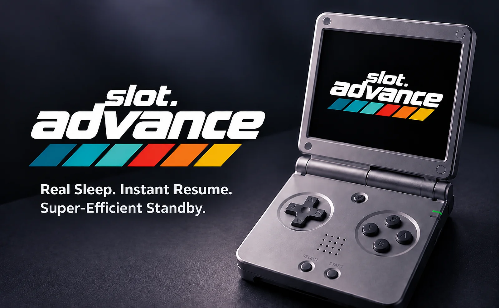
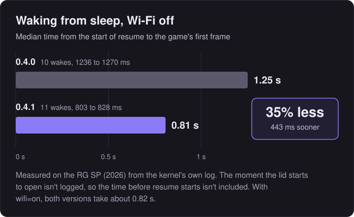

<div align="center">



# slot.advance

**A Game Boy Advance focused build of [slot](https://github.com/BrandonKowalski/slot) for the Anbernic RG SP (2026).**

35% less measured resume time with Wi-Fi off. [See the results](#faster-wake-up)

<a href="LICENSE"></a>
<a href="https://github.com/BrandonKowalski/slot"></a>
<a href="https://github.com/suprsomething/slot.advance/releases"></a>

</div>

> [!IMPORTANT]
> **Supported device: Anbernic RG SP (2026) only**: the clamshell model with the 720 x 480 display. Not compatible with the older RG35XX SP. For that model or any other Anbernic device, use upstream [slot](https://github.com/BrandonKowalski/slot).

**Current release:** [slot.advance 0.4.1](https://github.com/suprsomething/slot.advance/releases/tag/advance-0.4.1) · [`slot.advance-0.4.1-rg-sp.zip`](https://github.com/suprsomething/slot.advance/releases/download/advance-0.4.1/slot.advance-0.4.1-rg-sp.zip)<br>
**Previous release:** [slot.advance 0.4.0](https://github.com/suprsomething/slot.advance/releases/tag/advance-0.4.0) · [`slot.advance-0.4.0-rg-sp.zip`](https://github.com/suprsomething/slot.advance/releases/download/advance-0.4.0/slot.advance-0.4.0-rg-sp.zip)<br>
[Release notes](documentation/release-notes.md) · [How to install](#installing-and-updating)

**On this page**

- [What it does](#what-slotadvance-does)
- [Sleep and battery](#sleep-and-battery)
- [Installing and updating](#installing-and-updating)
- [Settings and controls](#configuration-and-controls)
- [Known limitations](#known-limitations)

**More documentation:** [User guide](documentation/user-guide.md) · [How sleep works](documentation/technical.md) · [How it was tested](documentation/sleep-and-battery.md) · [Release notes](documentation/release-notes.md)

---

## What slot.advance does

slot.advance brings genuine Linux suspend-to-RAM to the RG SP (2026). Close the lid and your game waits in memory, drawing a fraction of the power of the old standby. Open it, and you carry on from the same moment.

- **Real hardware sleep** with automatic **lid wake**. The running game stays in RAM, and nothing is reloaded.
- **Quicker wake-ups** with Wi-Fi off. See [Faster wake-up](#faster-wake-up).
- **Six sleep durations**, from 3 minutes to 8 hours, then a **clean automatic shutdown**. The game is restored at the next power-on.
- **About 2 to 3.2% of the battery an hour** asleep, as observed on the battery gauge. See [Sleep and battery](#sleep-and-battery).
- **All, Recents and Favourites** categories, **five save states** per game with an Up / Down switcher, and **per-game settings**.
- **Optional game titles**, an **About screen**, and a carousel that reopens on the last game played.

slot.advance is a fork of **[slot](https://github.com/BrandonKowalski/slot)** by **Brandon T. Kowalski**. The carousel, the cart shelf, the save-state switcher, link play and nearly everything else you see is his work. This fork adds features for one way of playing: GBA games on the 720 x 480 RG SP (2026). Watch the feature video on **[slotadvance.com](https://slotadvance.com/#video)**.

### What it looks like

<p align="center">

<br><sub><b>All</b>, with a starred favourite</sub>
</p>

<p align="center">


<br><sub><b>Recents</b>, newest first (left), and <b>Favourites</b> (right)</sub>
</p>

<p align="center">


<br><sub>The <b>save-state switcher</b> (left), and the <b>delete question</b> it asks first (right)</sub>
</p>

<sub>Screenshots are rendered from slot.advance's own drawing code at the RG SP (2026)'s 720 x 480, with user-supplied Pokémon Unbound artwork and labels from the [starter pack](artwork/gba-originals).</sub>

### Compared with slot

| | slot | slot.advance |
|---|---|---|
| Lid closed | Keeps running and drawing a black screen; powers off after 3 minutes | **Suspends to RAM**; opening the lid carries on; shuts down after the time set in **Settings > Sleep** |
| Wi-Fi | On whenever BaseOS starts it | **Off** unless you need link play |
| Categories | One shelf per platform | **All, Recents and Favourites**, switched with L2 / R2; **Y** stars a favourite |
| Save states | 10 per game, Left / Right switcher, instant delete | **5** per game (the oldest replaced), **Up / Down** as well, delete **asks first** |
| GBA screen shader | Grid by default | **Off** by default: GBA is an exact 3x on 720 x 480, already pixel perfect |
| Per-game settings | One setting for every game | **Each game remembers** its shader, colour correction and fast-forward choices |
| After a reboot | First cart on the shelf | **The game you played last** |

Every difference, including game titles, the About screen and the low-battery banners, is listed in the [User guide](documentation/user-guide.md#differences-from-slot).

---

## Sleep and battery

Close the lid, or tap `POWER`, and the RG SP (2026) goes into real hardware sleep with your game held in memory.

- **Open the lid** before the sleep time runs out, and the game carries on from the same moment, with nothing reloaded.
- **Leave it closed**, and when the time set in **Settings > Sleep** runs out (3 minutes to 8 hours, 30 minutes by default), it shuts down cleanly. The next power-on restores the game.

<p align="center">

</p>

- **Observed:** about **2 to 3.2% of the battery an hour** over three extended sleeps on 0.4.x, against about 7% for 0.3.0 (semi-stock) software standby, measured on a test build held in standby (ordinary 0.3.0 shuts down 3 minutes after the lid closes). These are battery-gauge readings in whole 1% steps, not a guaranteed range, and not a comparison between releases: whether 0.4.0 and 0.4.1 differ is inconclusive.
- **Estimated:** separate, shorter runs put the lid-closed current at about **250 mA** before hardware sleep and about **70 mA** after, around **72% less**. These are estimates from the gauge, not electrical measurements, and aren't calculated from the hourly figures.
- **Not claimed:** any change to battery use during gameplay.

### Faster wake-up

<p align="center">

</p>

With Wi-Fi off (the default), **0.4.1 shows your game 443 ms sooner after a wake**: a median of **0.81 s** against **1.25 s** in 0.4.0, 35% less measured time. That is the time from the kernel's first logged resume marker to the game's first rendered frame. It leaves out the moment the lid starts to open, so it isn't the whole wait from lifting the lid, and it isn't the kernel's total device-resume time. It was timed on 0.4.1-beta.1, whose runtime source is the same as 0.4.1's apart from the version number. With `wifi=on`, wakes take about 0.82 s on both versions; no improvement is claimed there.

The time saved is a stale Wi-Fi card that 0.4.0's wakes waited about a second for. 0.4.1 removes it once at start-up, after Wi-Fi switches off: [how it works](documentation/technical.md#the-041-wi-fi-card-removal) · [the measurements](documentation/sleep-and-battery.md#waking-up-faster-in-041).

### Safety nets

- **An unsaved game is never switched off by the timer.** If the game can't be written to the card when the lid closes, the RG SP (2026) keeps sleeping and retries the save.
- **Low battery:** sleep is planned to aim to preserve approximately 10% of the battery, and the 5% shutdown from slot still applies.
- **With the lid shut, `POWER` does nothing**, so the screen never lights inside a closed case. If hardware sleep fails, that sleep falls back to software standby.

**More detail:** the sleep-duration table, the two kinds of resume and every safety net are in the [User guide](documentation/user-guide.md#sleep-wake-and-automatic-shutdown). How it works is in the [Technical reference](documentation/technical.md). The measurements, raw logs and uncertainty are in [Sleep and battery: how it evolved and how it was measured](documentation/sleep-and-battery.md).

---

## Installing and updating

The download is **[slot.advance 0.4.1](https://github.com/suprsomething/slot.advance/releases/tag/advance-0.4.1)** ([`slot.advance-0.4.1-rg-sp.zip`](https://github.com/suprsomething/slot.advance/releases/download/advance-0.4.1/slot.advance-0.4.1-rg-sp.zip)). It is a complete games-card layout for the RG SP (2026). It holds no games, saves or settings, so it never overwrites yours. slot.advance runs on the same system card (SD1) as slot; if your RG SP (2026) already runs slot, skip to **Upgrading**.

The previous release, [slot.advance 0.4.0](https://github.com/suprsomething/slot.advance/releases/tag/advance-0.4.0) (`slot.advance-0.4.0-rg-sp.zip`), installs the same way and is the way back if you need it. So is [0.3.0](https://github.com/suprsomething/slot.advance/releases/tag/advance-v3), from before hardware sleep.

### New install

1. Follow the [slot guide](https://slot-cfw.fyi) to set up the system card (SD1) for the RG SP (2026).
2. Put your games card (SD2) in your computer, formatted as the slot guide describes.
3. Unzip `slot.advance-0.4.1-rg-sp.zip`. On a Mac, double-clicking it makes a folder called `slot.advance-0.4.1-rg-sp`.
4. Open that folder and copy **everything inside it** (`BIOS`, `Config`, `Games`, `Labels`, `Saves`, `States`, `System`, `Wallpapers`) onto the top level of the games card. Copy the contents, not the folder itself.
5. Put your `.gba` files in `Games/GBA` and, if you have it, the GBA BIOS (`gba_bios.bin`) in `BIOS`.
6. Eject the card, put it in the RG SP (2026)'s second slot, and power on. Set the clock when asked.

> [!IMPORTANT]
> ROMs must be unzipped. slot does not read `.zip` or `.7z` files.

### Upgrading from slot or an earlier slot.advance

1. Power off the RG SP (2026), then put the games card (SD2) in your computer.
2. *Optional:* to keep a way back, rename `System/slot` on the card to `slot.previous`.
3. Unzip the download and open its `System` folder. Select **everything inside it** and drag it into the `System` folder on the card. When asked, choose **Replace**. Your games, saves, states, favourites and settings are not in `System`, so they stay as they are.
4. Eject the card, put it back, and power on.

> [!WARNING]
> On a Mac, don't drag the download's top-level folders (`Games`, `Saves`, `States` and so on) onto the card's folders of the same name. They are empty, and Finder's **Replace** swaps a whole folder for the empty one, deleting what was in it. When upgrading, only the contents of `System` need copying.

The slot.advance **boot logo** appears from the second power-on: on the first start, slot writes it to the system card for the next boot, keeping the stock picture as a backup.

### Going back

Copy `System/slot` from an earlier download, such as [0.4.0](https://github.com/suprsomething/slot.advance/releases/tag/advance-0.4.0) or [0.3.0](https://github.com/suprsomething/slot.advance/releases/tag/advance-v3) (or your `slot.previous`), over `System/slot` on the card. Your saves and settings work with either.

---

## Configuration and controls

Press `MENU` on the carousel to open Settings.

### Settings

| Setting | Where | Choices |
|---|---|---|
| Sleep | Settings > Sleep | `3 min`, `15 min`, `30 min` (default), `1 hr`, `2 hr`, `8 hr` |
| Show Game Titles | Settings > Screen | Off (default) / On |
| GBA Shader, Color Correction and more | Settings > Screen | As in slot. Changes made in game apply to that game only |
| Fast Forward, Rewind, Turbo and more | Settings > Gameplay | As in slot |

### Controls

The everyday ones:

| Button | What it does |
|---|---|
| `L2` / `R2` on the carousel | Switch category: All, Recents, Favourites |
| `Y` on the carousel | Add or remove the game from Favourites |
| Tap / hold `A` on the carousel | Resume where you left off / start the game fresh |
| `SELECT` + `R1` in game | Save a state (five per game, the sixth replaces the oldest) |
| `SELECT` + `L1` in game | Load the most recent saved state |
| Double tap `MENU` in game | Open the save-state switcher |
| Hold `MENU` in game | Save, eject the cart and go back to the carousel |
| Close the lid, or tap `POWER` | Save to the suspend slot and sleep |

### Wi-Fi and link play

Wi-Fi is switched off, because only link play uses it, so the link shortcut shows **Link Off**. To use link play, add this line to `Config/slot.state` on the games card and restart:

```
wifi=on
```

**[Open the User guide](documentation/user-guide.md)** for every control, every setting, per-game settings, game titles, the files on the games card and troubleshooting.

---

## Known limitations

- **Rapidly flicking the lid** closed and open can occasionally leave the screen dark with the lid open. Deliberate stress testing reproduced this in both 0.4.0 and 0.4.1. Normal wake behaviour is unaffected, and closing and reopening the lid restores the game without losing progress. See [Validation status](documentation/sleep-and-battery.md#validation-status).
- **The faster wake can occasionally be missed for one session.** If the lid is closed at almost exactly the moment Wi-Fi switches off, about 20 seconds after power-on, the stale Wi-Fi card may not be removed. Sleep and wake still work normally; wakes in that session simply take as long as in 0.4.0, and the next power-on removes it as usual.
- **Battery figures come from the battery gauge**, which reads in whole 1% steps, with one run per configuration. See [Methodology and uncertainty](documentation/sleep-and-battery.md#methodology-and-uncertainty).
- **Link play needs `wifi=on`**. With it on, the radio stays powered.
- **The sleep timer always ends with a shutdown**, even on the charger. The game is restored at the next power-on.

### Reporting a problem

1. **Don't power on again yet.** `slot.log` and `slot.log.1` are replaced each time slot.advance starts, so the record of the problem is on the card only until the next start or two.
2. Power off, take the games card (SD2) out and put it in your computer. Copy `slot.log` and `slot.log.1` from the top of the card somewhere safe.
3. [Open an issue](https://github.com/suprsomething/slot.advance/issues/new/choose) and choose **Bug report**. Say which version you're on (the first line of `slot.log`), what you were doing and what you saw, then drag both log files into the issue.

---

## Versions

This build: **0.4.1**

Every release is on the [releases page](https://github.com/suprsomething/slot.advance/releases). What changed in each, and how versions are numbered, is in the [release notes](documentation/release-notes.md). The first line of `slot.log` names the version and Git commit a build came from. [CHANGELOG.md](CHANGELOG.md) is upstream slot's changelog, inherited unchanged.

---

## Credits and acknowledgements

- **[slot](https://github.com/BrandonKowalski/slot)** by Brandon T. Kowalski: the frontend this fork is built on.
- **slots** by **[ciscosweater](https://github.com/ciscosweater)**: the Recents category is adapted from this community fork of slot, and its favourites tab inspired ours.
- **[mGBA](https://mgba.io)** by endrift and **[gpSP](https://github.com/libretro/gpsp)** through [libretro](https://www.libretro.com): the emulation.
- **[AGS-102](https://github.com/BrandonKowalski/AGS-102)**, a fork of [BaseOS](https://github.com/pvaibhav/BaseOS) by @pvaibhav: the operating system slot boots on.
- **[Open Sans](https://github.com/googlefonts/opensans)** (SIL Open Font License) and **[Nerd Fonts](https://www.nerdfonts.com)** symbols by Ryan L McIntyre (MIT), including the favourite star.
- The LCD3x screen shader's panel mask is derived from **gigaherz's LCD3x**.
- The cart sounds are recordings of Brandon T. Kowalski's childhood Game Boy.
- The cartridge-label photographs in the [starter pack](artwork/gba-originals) are credited to their photographers in its README.
- Both slot and slot.advance were built with **Claude** (see [AI disclosure](#ai-disclosure)).

slot.advance is released under the same licence as slot, the [GNU GPL v3 or later](LICENSE).

---

## AI disclosure

slot's Rust frontend was put together with Claude Opus and reviewed by its author.

The changes in this fork were also written with Claude (Anthropic), at my direction, and checked with slot's own automated test suite plus new tests for each feature. The battery charts and README screenshots were generated from the development test results and slot.advance's own drawing code.
