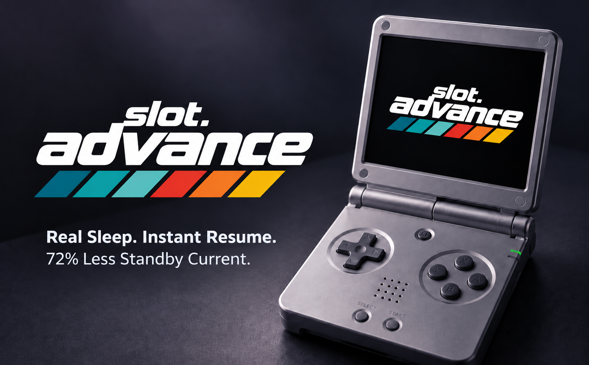
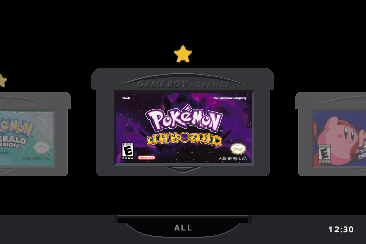
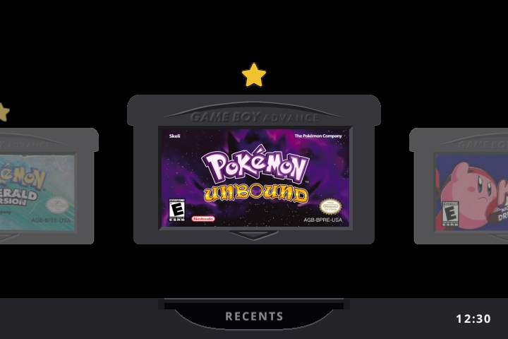
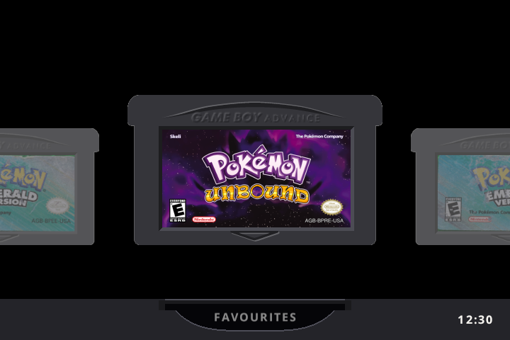
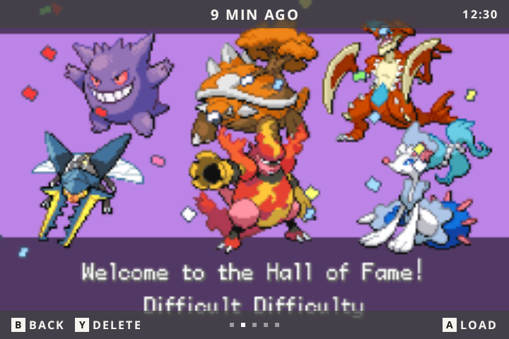
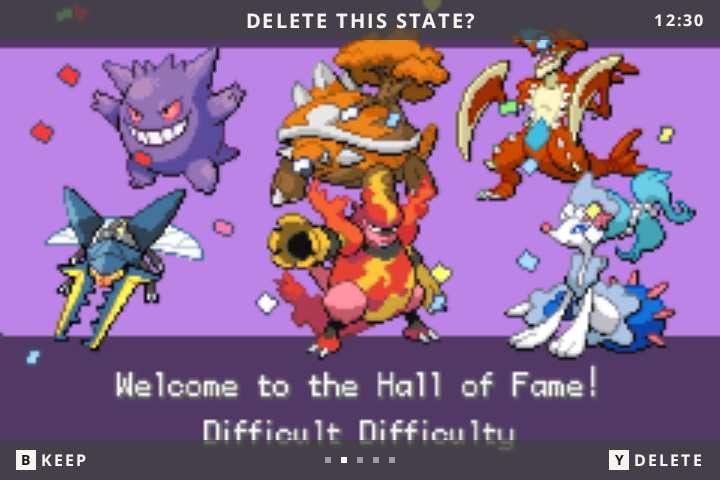
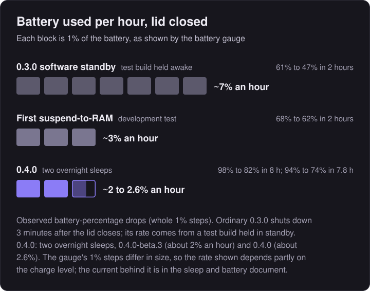
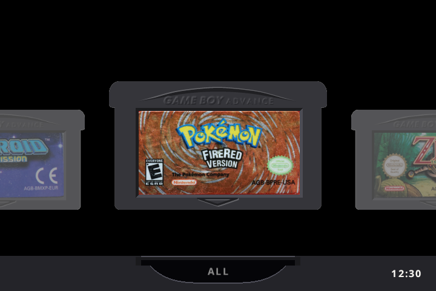

<div align="center">



# slot.advance

**A Game Boy Advance focused build of [slot](https://github.com/BrandonKowalski/slot) for the Anbernic RG SP (2026).**

<sub>Approximately 72% lower estimated standby current than continuous software standby, in preliminary development testing. The optimised result came from an experiment reproducing 0.4.0's configuration, not a battery measurement of the integrated release build. <a href="documentation/sleep-and-battery.md">How it was measured</a>.</sub>

<a href="LICENSE"></a>
<a href="https://github.com/BrandonKowalski/slot"></a>
<a href="https://github.com/suprsomething/slot.advance/releases"></a>

</div>

| Release | Version | Description |
|---|---|---|
| **Current beta** | **[slot.advance 0.4.0-beta.3](https://github.com/suprsomething/slot.advance/releases/tag/advance-0.4.0-beta.3)**<br>[`slot-advance-0.4.0-beta.3-rg-sp.zip`](https://github.com/suprsomething/slot.advance/releases/download/advance-0.4.0-beta.3/slot-advance-0.4.0-beta.3-rg-sp.zip) | Latest build with hardware sleep, improved standby efficiency, configurable sleep settings and optional game-title display. |
| **Previous release** | [slot.advance 0.3.0](https://github.com/suprsomething/slot.advance/releases/tag/advance-v3)<br>[`slot-advance-v3-rg-sp.zip`](https://github.com/suprsomething/slot.advance/releases/download/advance-v3/slot-advance-v3-rg-sp.zip) | Earlier version without hardware sleep or game-title display. |

**Beta status:** Version 0.4.0-beta.3 is a beta undergoing real-world testing. Once [validated](documentation/sleep-and-battery.md#validation-status), it will form the basis of the stable 0.4.0 release. See [Installing and updating](#installing-and-updating).

> [!IMPORTANT]
> **Supported device: Anbernic RG SP (2026) only**: the clamshell model with the 720 x 480 display. Not compatible with the older RG35XX SP. For that model or any other Anbernic device, use upstream [slot](https://github.com/BrandonKowalski/slot).

---

# What slot.advance does

slot.advance brings genuine Linux suspend-to-RAM to the RG SP (2026). Close the lid and your game waits in memory, drawing a fraction of the power of the old standby. Open it, and you carry on from the same moment.

- **Real hardware sleep** with automatic **lid wake**. The running game stays in RAM, and nothing is reloaded. *(0.4.0)*
- **Six sleep durations**, from 3 minutes to 8 hours, then a **clean automatic shutdown**. The game is restored at the next power-on. *(0.4.0)*
- **About 2% of the battery per hour** while asleep in the optimised configuration, against about 7% for software standby held awake. *(0.4.0, preliminary)*
- **Optional game titles** above the selected cartridge. *(0.4.0)*
- **All, Recents and Favourites** categories, **five save states** per game with an Up / Down switcher, **per-game settings**, and a carousel that reopens on the last game played.

slot.advance is a fork of **[slot](https://github.com/BrandonKowalski/slot)** by **Brandon T. Kowalski**. The carousel, the cart shelf, the save-state switcher, link play and nearly everything else you see is his work. This fork adds features for one way of playing: GBA games on the 720 x 480 RG SP (2026).

### Compared with slot

| | slot | slot.advance |
|---|---|---|
| Lid closed | Keeps running and drawing a black screen; powers off after 3 minutes | **Suspends to RAM**; opening the lid carries on; shuts down after the time set in **Settings > Sleep** *(0.4.0)* |
| Wi-Fi | On whenever BaseOS starts it | **Off** unless you need link play. See [Wi-Fi and link play](#wi-fi-and-link-play) *(0.4.0)* |
| Game titles | None | **Optional**, off by default. See [Game titles](#optional-game-titles) *(0.4.0)* |
| Categories | One shelf per platform | **All, Recents and Favourites**, switched with L2 / R2 |
| Favourites | None | **Y** stars a game; a gold star marks it on the shelf |
| Recently played | None | The last **10** games started, newest first |
| Manual save states | 10 per game | **5** per game, the oldest replaced by the newest |
| Save-state switcher | Left / Right | **Up / Down** as well |
| Deleting a state | Instant | **Asks first**: Y, then Y again |
| GBA screen shader | Grid by default | **Off** by default (GBA is an exact 3x on a 720 x 480 screen, so it is already pixel perfect) |
| Per-game settings | One setting for every game | **Each game remembers** its shader, colour correction, fast-forward speed and fast-forward sound |
| After a reboot | First cart on the shelf | **The game you played last**, in the category you started it from |
| Low battery | Shuts down at 5% | A quiet **banner at 15% and 10%** first, then the same 5% shutdown |

<sub>Rows marked *(0.4.0)* are new in the 0.4.0 beta and not in 0.3.0. Everything else is in both.</sub>

### What it looks like

<p align="center">

<br><sub><b>All</b>, with a starred favourite</sub>
</p>

<p align="center">


<br><sub><b>Recents</b>, newest first (left), and <b>Favourites</b> (right)</sub>
</p>

<p align="center">


<br><sub>The <b>save-state switcher</b> (left), and the <b>delete question</b> it asks first (right)</sub>
</p>

<sub>Screenshots are rendered from slot.advance's own drawing code at the RG SP (2026)'s 720 x 480, with user-supplied Pokémon Unbound artwork and labels from the [starter pack](artwork/gba-originals).</sub>

---

# Sleep and battery

### Battery used with the lid closed

<p align="center">

</p>

- **Preliminary development figures**, read from the battery gauge in whole 1% steps. The estimated current fell from about **250 mA** to about **70 mA**, around **72% less**.
- **0.3.0 software standby, test build held awake.** Ordinary 0.3.0 shuts down 3 minutes after the lid closes. Its hourly figure comes from a test build deliberately held in standby.
- **The 2% figure** comes from an experiment reproducing 0.4.0's settings, not from a battery test of the 0.4.0 build.
- **The point of 0.4.0 isn't to beat switching off.** A switched-off RG SP (2026) draws only a negligible amount compared with any standby. 0.4.0 lets it stay asleep efficiently for hours and wake the moment you open the lid.
- No change to battery use **during gameplay** has been measured or claimed.

The current-draw chart, the long-sleep projection, the raw logs and the uncertainty calculations are in **[Sleep and battery: how it works and how it was measured](documentation/sleep-and-battery.md)**.

### Sleep duration

**Settings > Sleep** sets how long the RG SP (2026) stays asleep with the lid closed before it shuts down by itself. Press `MENU` on the carousel to open Settings.

| Setting | Asleep for up to | Projected battery used, if asleep the whole time |
|---|---|---|
| `3 min` | 3 minutes | under 0.2% |
| `15 min` | 15 minutes | ~0.5% |
| `30 min` (default) | 30 minutes | ~1% |
| `1 hr` | 1 hour | ~2% |
| `2 hr` | 2 hours | ~4% |
| `8 hr` | 8 hours | ~16% |

<sub>Projected at ~2% an hour from the preliminary figure; real use varies with battery age, temperature and charge level. Longer settings are more convenient but use more battery.</sub>

### Waking up: two kinds of resume

| | When | What happens |
|---|---|---|
| **Wake from RAM** | You open the lid before the sleep time runs out | The RG SP (2026) wakes and the game **carries on from the same moment**. It never stopped, so nothing is reloaded. |
| **Boot and restore** | The sleep time runs out with the lid still closed | The clock wakes it briefly and it **shuts down cleanly**. At the next power-on it boots and **restores the game from its suspend slot** (`resume.state`). This takes a few seconds longer, but you lose nothing. |

Before sleeping, slot.advance attempts to save your game to its separate suspend slot. It never touches your five save states. If that save fails, the timer won't switch the RG SP (2026) off: see **Safety nets** below.

### Safety nets

- **Unsaved games are never switched off by the timer.** If the game can't be written to the card when the lid closes, the RG SP (2026) keeps sleeping and retries the save; only the 5% battery shutdown can end it.
- **Low battery:** sleep is planned to aim to preserve approximately 10% of the battery, waking and shutting down early if needed. At 10% or less it sleeps for 3 minutes. At 5% it saves and shuts down, as in slot.
- **With the lid shut, `POWER` does nothing**, so the screen never lights inside a closed case. A charger or other stray wake sends it straight back to sleep.
- **If hardware sleep isn't available or fails**, that sleep falls back to 0.3.0's software standby (screen off, shuts down after 3 minutes).
- Each sleep and wake is written to `slot.log` on the games card.

---

# Optional game titles

**Settings > Screen > Show Game Titles** puts the selected game's title in small text above its cartridge on the carousel. *(0.4.0)*

<table>
<tr>
<td width="50%" align="center"><br><sub><b>Show Game Titles: Off</b> (the default)</sub></td>
<td width="50%" align="center"><br><sub><b>Show Game Titles: On</b></sub></td>
</tr>
</table>

- **Off by default**: with it off, the carousel looks exactly as before. Changes take effect straight away and are **remembered** after a restart (`show_titles` in `Config/slot.state`).
- **Only the selected cartridge** shows a title, centred above it in a fixed space, never over its neighbours.
- **The title comes from the file name**, minus naming tags such as `(USA)`, `(Rev 1)`, `(V1.1)` or `[!]`. Your files are never renamed: `Pokemon - Fire Red Version (U) (V1.1).gba` shows as **POKEMON - FIRE RED VERSION**.
- **Long titles** show cut short with "…" for 2 seconds, then scroll slowly to their end, pause, and start again. Scrolling stops while Settings is open or the device is asleep.

<sub>Rendered by slot.advance's own drawing code with labels from the [starter pack](artwork/gba-originals); regenerate with `cargo run -p slot --no-default-features --example readme_titles`.</sub>

---

# Installing and updating

The download, the current beta, is **[slot.advance 0.4.0-beta.3](https://github.com/suprsomething/slot.advance/releases/tag/advance-0.4.0-beta.3)** ([`slot-advance-0.4.0-beta.3-rg-sp.zip`](https://github.com/suprsomething/slot.advance/releases/download/advance-0.4.0-beta.3/slot-advance-0.4.0-beta.3-rg-sp.zip)). It is a beta, still being tested on the device. It is a complete games-card layout for the RG SP (2026). It holds no games, saves or settings, so it never overwrites yours. slot.advance runs on the same system card (SD1) as slot; if your RG SP (2026) already runs slot, skip to **Upgrading**.

The previous release, [slot.advance 0.3.0](https://github.com/suprsomething/slot.advance/releases/tag/advance-v3) (`slot-advance-v3-rg-sp.zip`), installs the same way and is the way back if you need it.

### New install

1. Follow the [slot guide](https://slot-cfw.fyi) to set up the system card (SD1) for the RG SP (2026).
2. Put your games card (SD2) in your computer, formatted as the slot guide describes.
3. Unzip `slot-advance-0.4.0-beta.3-rg-sp.zip`. On a Mac, double-clicking it makes a folder called `slot-advance-0.4.0-beta.3-rg-sp`.
4. Open that folder and copy **everything inside it** (`BIOS`, `Config`, `Games`, `Labels`, `Saves`, `States`, `System`, `Wallpapers`) onto the top level of the games card. Copy the contents, not the folder itself.
5. Put your `.gba` files in `Games/GBA` and, if you have it, the GBA BIOS (`gba_bios.bin`) in `BIOS`.
6. Eject the card, put it in the RG SP (2026)'s second slot, and power on. Set the clock when asked.

> [!IMPORTANT]
> ROMs must be unzipped. slot does not read `.zip` or `.7z` files.

### Upgrading from slot or an earlier slot.advance

1. Power off the RG SP (2026), then put the games card (SD2) in your computer.
2. *Optional:* to keep a way back, rename `System/slot` on the card to `slot.previous`.
3. Unzip the download and open its `System` folder. Select **everything inside it** and drag it into the `System` folder on the card. When asked, choose **Replace**. Your games, saves, states, favourites and settings are not in `System`, so they stay as they are.
4. Eject the card, put it back, and power on.

> [!WARNING]
> On a Mac, don't drag the download's top-level folders (`Games`, `Saves`, `States` and so on) onto the card's folders of the same name. They are empty, and Finder's **Replace** swaps a whole folder for the empty one, deleting what was in it. When upgrading, only the contents of `System` need copying.

The slot.advance **boot logo** appears from the second power-on: on the first start, slot writes it to the system card for the next boot, keeping the stock picture as a backup.

### Going back

Copy `System/slot` from an earlier download, such as [0.3.0](https://github.com/suprsomething/slot.advance/releases/tag/advance-v3) (or your `slot.previous`), over `System/slot` on the card. Your saves and settings work with either.

---

# Configuration and controls

### Settings

Press `MENU` on the carousel.

| Setting | Where | Choices |
|---|---|---|
| Sleep *(0.4.0)* | Settings > Sleep | `3 min`, `15 min`, `30 min` (default), `1 hr`, `2 hr`, `8 hr` |
| Show Game Titles *(0.4.0)* | Settings > Screen | Off (default) / On |
| GBA Shader, Color Correction and more | Settings > Screen | As in slot. Changes made in game apply to that game only |
| Fast Forward, Rewind, Turbo and more | Settings > Gameplay | As in slot |

### Wi-Fi and link play

From 0.4.0, slot.advance switches Wi-Fi off about 20 seconds after starting, because only link play uses it. It also switches off six USB host controllers the RG SP (2026) has no ports for; the USB-C port has its own controller and still works for charging. BaseOS turns both back on at the next boot.

Link play (the link cable and the wireless adapter) runs over Wi-Fi between two devices, so with Wi-Fi off the link shortcut shows **Link Off**. To use link play, add this line to `Config/slot.state` on the games card and restart:

```
wifi=on
```

### Low battery

| Battery | What happens |
|---|---|
| 15% | A small "Battery Low: 15%" banner at the top of the screen. **New** |
| 10% | A small "Battery Low: 10%" banner. **New** |
| 5% | Your game is saved and the RG SP (2026) powers off, as in slot. |

Each banner appears once per discharge, in game or on the carousel. Nothing appears while charging, and plugging in resets both. The battery is checked every 10 seconds, so after a sleep a banner shows within about 10 seconds of waking.

### Controls

Buttons side by side mean either one. A `+` means both together. **New** marks what this fork adds or changes.

#### On the carousel

| Button | What it does | |
|---|---|---|
| `Left` / `Right` | Move along the shelf | |
| `Up` / `Down` | Skip to the next letter | |
| `L2` / `R2` | Switch category: All, Recents, Favourites (empty ones are skipped) | **New** |
| `Y` | Add or remove the game from Favourites | **New** |
| `L1` / `R1` | Same as `L2` / `R2` (and steps through GB and GBC shelves if you have those games too) | |
| Tap `A` | Resume where you left off | |
| Hold `A` | Start the game fresh | |
| `START` | Choose which emulator runs the cart (mGBA or gpSP) | |
| `MENU` | Settings | |

#### In game

Shader, colour correction and fast-forward changes made in game are saved **for that game only**. Games you have never changed follow the defaults in Settings.

| Button | What it does | |
|---|---|---|
| `SELECT` + `R1` | Save a state (five per game, the sixth replaces the oldest) | **New** |
| `SELECT` + `L1` | Load the most recent saved state | |
| Double tap `MENU` | Open the save-state switcher | |
| Hold `MENU` | Save, eject the cart and go back to the carousel | |
| `SELECT` + `B` / `A` | Previous / next screen shader, named in a banner at the top | |
| `SELECT` + `Y` | Toggle colour correction | |
| `SELECT` + `L2` / `R2` | Slower / faster fast-forward (2x, 3x, 4x, 6x), for this game | **New** |
| `SELECT` + `X` | Fast-forward sound on / off, for this game | **New** |
| Hold `L2` | Rewind | |
| Hold `R2` | Fast-forward | |
| Double tap `R2` | Lock fast-forward on; press again to unlock | |
| Hold `X` / `Y` | Turbo A / Turbo B | |
| `SELECT` + `MENU` | Link with another device running slot (needs `wifi=on` from 0.4.0) | |
| Close the lid, or tap `POWER` | Save to the suspend slot and sleep. This never touches your five states | **New** |

#### In the save-state switcher

| Button | What it does | |
|---|---|---|
| `Up` / `Down` or `Left` / `Right` | Newer / older state | **New** |
| `A` | Load the state on screen. Nothing loads just by moving to it | |
| `B` or `MENU` | Back to the game | |
| `Y` | Delete: asks "Delete this state?" | **New** |
| `Y` again | Confirm the delete. Any other button keeps the state | **New** |
| `X` | Undo the last save or load, up to 30 seconds after | |

#### Anywhere

| Button | What it does |
|---|---|
| `SELECT` + `Up` / `Down` | Brightness |
| `SELECT` + `Left` / `Right` | Blue light filter |
| `VOL+` / `VOL-` | Volume |
| `VOL+` + `VOL-`, or `SELECT` + a volume key | Mute |

### Where things are kept on the games card

| File or folder | What it holds |
|---|---|
| `Config/slot.state` | Your settings, including `sleep_minutes`, `show_titles` and `wifi`. |
| `Config/favourites.txt` | Your favourites, one per line, e.g. `GBA/Mother 3 (Japan)`. Safe to edit on a computer. |
| `Config/recents.txt` | Recently played games, newest first. |
| `Config/game_profiles.txt` | Each game's own shader, colour correction and fast-forward choices. Delete a game's lines to put it back on the defaults. |
| `System/bootlogo.bmp` | The slot.advance boot logo. Put your own 24-bit `.bmp` at `Config/bootlogo.bmp` to use that instead. See [artwork/bootlogo](artwork/bootlogo). |
| `States/GBA/<core>/<game>/` | Up to five save states, named by the time they were saved, plus `resume.state`, the suspend slot used when the lid closes. |
| `States/GBA/<core>/<game>/older/` | States moved out of the switcher when a game had more than five from an earlier version. Nothing is deleted. |
| `Saves/GBA/` | Battery saves (`.sav` / `.srm`), exactly as in slot. |
| `slot.log`, `slot.log.1` | What slot.advance did this session and the one before, including each sleep and wake. The first line names the exact build, e.g. `slot advance 0.4.0-beta.3 (` followed by the commit and build date. |

The `.txt` files and `slot.state` live in `Config/`, so replacing `System/` on an update leaves them alone.

---

# Known limitations

- **0.4.0 is a beta.** On the device, sleep and resume from inside a game and the timed shutdown have worked. Still being confirmed: plugging in or unplugging the charger while asleep, rumble and headphones after many sleeps, and rapid lid flicks with the beta.3 fix. See [Validation status](documentation/sleep-and-battery.md#validation-status).
- **Battery figures are preliminary**, from single development runs with the battery gauge.
- **Link play needs `wifi=on`** from 0.4.0. With it on, the radio stays powered.
- **The sleep timer always ends with a shutdown**, even on the charger. The game is restored at the next power-on.

On 0.4.0-beta.1 and beta.2, after rapid lid flicks, opening the lid could leave the screen dark for a few seconds before the game came back. 0.4.0-beta.3 fixes the likely cause; it is waiting to be confirmed on the device.

### Reporting a problem

1. **Don't power on again yet.** `slot.log` and `slot.log.1` are replaced each time slot.advance starts, so the record of the problem is on the card only until the next start or two.
2. Power off, take the games card (SD2) out and put it in your computer. Copy `slot.log` and `slot.log.1` from the top of the card somewhere safe.
3. [Open an issue](https://github.com/suprsomething/slot.advance/issues/new/choose) and choose **Bug report**. Say which version you're on (the first line of `slot.log`), what you were doing and what you saw, then drag both log files into the issue.

---

# Versions

This build: **0.4.0-beta.3**

From 0.4.0, slot.advance uses [semantic versioning](https://semver.org): `MAJOR.MINOR.PATCH`.

- A **test build** has a pre-release suffix, such as `0.4.0-beta.1`. If a beta needs fixing, the next one is `0.4.0-beta.2`.
- Once a beta is approved on the RG SP (2026), the same code is released as `0.4.0`.
- A **fix** to a release raises the last number (`0.4.1`); **new features** raise the middle one (`0.5.0`).
- Releases on GitHub are tagged with an `advance-` prefix, such as `advance-0.4.0`, to keep them apart from upstream slot's tags in this repository. 0.3.0 keeps its original tag, `advance-v3`.
- From the stable 0.4.0 release, downloads are named `slot.advance-<version>-rg-sp.zip`, such as `slot.advance-0.4.0-rg-sp.zip`. Earlier downloads, including the 0.4.0 betas, keep their original `slot-advance-…` names.

The version and Git commit a build came from are written as the first line of `slot.log`. slot.advance's own release notes are in [documentation/release-notes.md](documentation/release-notes.md). [CHANGELOG.md](CHANGELOG.md) is upstream slot's changelog, inherited unchanged.

---

# Credits and acknowledgements

- **[slot](https://github.com/BrandonKowalski/slot)** by Brandon T. Kowalski: the frontend this fork is built on.
- **slots** by **[ciscosweater](https://github.com/ciscosweater)**: the Recents category is adapted from this community fork of slot, and its favourites tab inspired ours.
- **[mGBA](https://mgba.io)** by endrift and **[gpSP](https://github.com/libretro/gpsp)** through [libretro](https://www.libretro.com): the emulation.
- **[AGS-102](https://github.com/BrandonKowalski/AGS-102)**, a fork of [BaseOS](https://github.com/pvaibhav/BaseOS) by @pvaibhav: the operating system slot boots on.
- **[Open Sans](https://github.com/googlefonts/opensans)** (SIL Open Font License) and **[Nerd Fonts](https://www.nerdfonts.com)** symbols by Ryan L McIntyre (MIT), including the favourite star.
- The LCD3x screen shader's panel mask is derived from **gigaherz's LCD3x**.
- The cart sounds are recordings of Brandon T. Kowalski's childhood Game Boy.
- The cartridge-label photographs in the [starter pack](artwork/gba-originals) are credited to their photographers in its README.
- Both slot and slot.advance were built with **Claude** (see [AI disclosure](#ai-disclosure)).

slot.advance is released under the same licence as slot, the [GNU GPL v3 or later](LICENSE).

---

# AI disclosure

slot's Rust frontend was put together with Claude Opus and reviewed by its author.

The changes in this fork were also written with Claude (Anthropic), at my direction, and checked with slot's own automated test suite plus new tests for each feature. The battery charts and README screenshots were generated from the development test results and slot.advance's own drawing code.
