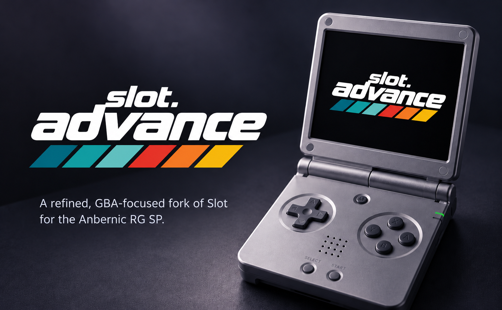

<div align="center">



# slot advance

**A Game Boy Advance focused build of [slot](https://github.com/BrandonKowalski/slot) for the Anbernic RG SP (2026).**

### Real Sleep. Instant Resume. 72% Less Standby Current.

<a href="LICENSE"></a>
<a href="https://github.com/BrandonKowalski/slot"></a>
<a href="https://slot-cfw.fyi"></a>

</div>

slot advance brings genuine Linux suspend-to-RAM to the Anbernic RG SP (2026), dramatically reducing standby power consumption while keeping your game ready to resume.

Development testing indicates approximately **72% lower standby current draw** compared with continuous software standby, reducing estimated battery consumption from **7% to about 2% per hour**.

Close the lid, and your game waits in memory. Open it again, and you pick up exactly where you left off.

> [!NOTE]
> This page describes **0.4.0-beta.1**, which is being tested on the RG SP (2026) and has not been published as a download yet. The current release is **v3 (0.3.0)**; see [Installing and updating](#installing-and-updating).

> [!IMPORTANT]
> slot advance is built for the **Anbernic RG SP (2026)** only: the clamshell model with the 720 x 480 screen. It is **not** for the older RG35XX SP. For that model, or any other Anbernic device, use the original [slot](https://github.com/BrandonKowalski/slot).

---

# Key features

- **Genuine hardware sleep.** Closing the lid suspends the RG SP (2026) to RAM, rather than leaving it running with the screen off.
- **About 72% lower standby current** than software standby in development testing: roughly 70 mA instead of 250 mA.
- **About 2% of the battery per hour** while asleep, in the optimised configuration.
- **Wakes when you open the lid**, with the game still in memory. Nothing is reloaded.
- **Six sleep durations**, from 3 minutes to 8 hours, in **Settings > Sleep**.
- **Clean automatic shutdown** when the chosen time runs out, and the game resumes at the next power-on.
- **Optional game titles** above the selected cartridge on the carousel.
- **GBA-first conveniences** on top of slot: All, Recents and Favourites; five save states per game; per-game settings; and the carousel reopens on the last game played.

slot advance is a fork of **[slot](https://github.com/BrandonKowalski/slot)** by **Brandon T. Kowalski**. The carousel, the cart shelf, the save-state switcher, link play and nearly everything else you see is his work. This fork adds features for one particular way of playing: GBA games on the 720 x 480 RG SP (2026).

### Compared with slot

| | slot | slot advance |
|---|---|---|
| Lid closed | Keeps running and drawing a black screen, then powers off after 3 minutes | **Suspends to RAM.** Opening the lid carries on; powers off after the time chosen in **Settings > Sleep** (30 minutes by default) |
| Wi-Fi | On whenever BaseOS starts it | **Off**, because only link play uses it. See [Wi-Fi and link play](#wi-fi-and-link-play) |
| Categories | One shelf per platform | **All, Recents and Favourites**, switched with L2 / R2 |
| Favourites | None | **Y** stars a game; a gold star marks it on the shelf |
| Recently played | None | The last **10** games started, newest first |
| Manual save states | 10 per game | **5** per game, the oldest replaced by the newest |
| Save-state switcher | Left / Right | **Up / Down** as well |
| Deleting a state | Instant | **Asks first**: Y, then Y again |
| GBA screen shader | Grid by default | **Off** by default (GBA is an exact 3x on a 720 x 480 screen, so it is already pixel perfect) |
| Per-game settings | One setting for every game | **Each game remembers** its shader, colour correction, fast-forward speed and fast-forward sound |
| After a reboot | First cart on the shelf | **The game you played last**, in the category you started it from |
| Game titles | None | **Optional**, off by default. See [Game titles](#optional-game-titles) |
| Low battery | Shuts down at 5% | A quiet **banner at 15% and 10%** first, then the same 5% shutdown |

Everything else works the way slot does, including quick save and load, rewind, fast-forward and the mGBA / gpSP core picker. Link play is still there, but needs Wi-Fi turned back on first.

### What it looks like

<p align="center">

</p>

<p align="center">


</p>

<p align="center">


</p>

<sub>All screenshots on this page are rendered from slot advance's own drawing code at the RG SP (2026)'s 720 x 480. The shelves use user-supplied Pokémon Unbound label artwork and labels from the [starter pack](artwork/gba-originals). The switcher uses a user-supplied Pokémon Unbound Hall of Fame screenshot.</sub>

---

# Battery efficiency

Closing the lid now puts the RG SP (2026) into real hardware sleep. In development testing, that cut the current drawn with the lid closed from about **250 mA** to about **70 mA**.

<p align="center">

</p>

| Lid closed | Current draw | Battery per hour | What it is |
|---|---|---|---|
| v3 software standby | ~250 mA | ~7% | The released v3, held in standby by a test build |
| First suspend-to-RAM | ~105 mA | ~3% | A development test: hardware sleep with USB and Wi-Fi still on |
| **0.4.0 configuration** | **~70 mA** | **~2%** | Hardware sleep with the unused USB controllers and Wi-Fi off |

<p align="center">

</p>

> [!NOTE]
> These are development-test figures. The ~70 mA result comes from the optimised configuration reproduced in a development experiment, **not** a direct measurement of the integrated 0.4.0 release build. How they were obtained, and how sure they are, is set out in [Battery testing and methodology](#battery-testing-and-methodology).

### How much battery a long sleep uses

<p align="center">

</p>

| Asleep for | Estimated battery used |
|---|---|
| 30 minutes | ~1% |
| 1 hour | ~2% |
| 2 hours | ~4% |
| 4 hours | ~8% |
| 8 hours | ~16% |

This is a **projection** from about 2% an hour, not a measurement of each duration. Real results vary with the battery's age and condition, temperature and charge level. The RG SP (2026) only stays asleep this long if **Settings > Sleep** is set long enough; see [Sleep duration](#configurable-sleep-duration).

> [!IMPORTANT]
> **A fair comparison with v3.** v3 normally powers off 3 minutes after the lid closes, so it never actually spends an hour in standby. Its ~7% an hour comes from a test build that stayed in standby on purpose. A powered-off RG SP (2026) uses no battery at all, so the benefit of 0.4.0 isn't longer battery life than switching off. It's being able to **stay asleep efficiently for hours and still wake instantly when you open the lid**.

---

# The evolution of sleep

### Original slot: software standby

Closing the lid turned off the screen's backlight, but everything else kept going. The CPU kept running, and the drawing loop kept producing a black frame about 60 times a second, matched to the display. The game was paused and saved, and after 3 minutes the device powered off. The next power-on reloaded the game from its suspend slot.

### slot advance v3: quieter software standby

v3 stopped the wasted drawing. Once the screen is dark, slot advance draws two black frames and then nothing at all. It only wakes every 50 ms to check the buttons, the lid and its timers. The CPU, memory and display hardware stay powered, so the RG SP (2026) is still fully awake behind a dark screen. Development testing measured about **250 mA** (about **7% an hour**) in this state, held there by a test build. v3 itself still powers off after 3 minutes.

### slot advance 0.4.0: real suspend-to-RAM

0.4.0 asks Linux to suspend the whole system to RAM. When the lid closes:

1. **The game is saved first.** Its suspend slot (`resume.state`) and battery save are written and flushed to the card before anything else happens.
2. **Drawing stops**, as in v3, and the emulator is paused.
3. **The system suspends.** slot advance itself is frozen mid-loop, the display and other devices are suspended by their drivers, and the processor powers down. Memory stays powered, so the running game is preserved exactly as it was.
4. **Unused hardware is already off.** From startup, slot advance switches off six USB host controllers the RG SP (2026) has no ports for, and the Wi-Fi radio.
5. **Wake sources stay armed.** Opening the lid, a timer (for the sleep duration) and `POWER` can all wake the device.

Development testing of this configuration measured about **70 mA**, roughly **2% an hour**. That is about **72% less** standby current than software standby.

> [!TIP]
> **Why keep lid wake?** The RG SP (2026)'s firmware has a deeper sleep mode in which the lid can't wake the device. In testing, it drew only about 7 mA less (roughly 10%), but you'd have to press `POWER` to wake it. slot advance keeps lid wake on, trading a small amount of power for opening the lid and carrying on.

| | Original slot | slot advance v3 | slot advance 0.4.0 |
|---|---|---|---|
| CPU | Running | Running, mostly idle | Suspended |
| Drawing | Black frames, ~60 a second | Stopped | Stopped |
| Display | Backlight off | Backlight off | Suspended |
| Memory | Active | Active | Kept powered, game preserved |
| Unused USB and Wi-Fi | On | On | Off |
| Emulator | Paused | Paused | Paused and frozen with the system |
| Lid closed, then | Powers off after 3 minutes | Powers off after 3 minutes | Sleeps for the chosen time (3 minutes to 8 hours), then powers off |
| Opening the lid | Carries on if still awake | Carries on if still awake | Wakes from RAM and carries on |
| Measured current | Not measured | ~250 mA | ~70 mA (development configuration) |

---

# Configurable sleep duration

**Settings > Sleep** sets how long the RG SP (2026) sleeps with the lid closed before it shuts down by itself. Press `MENU` on the carousel to open Settings.

| In the menu | Sleeps for | Battery used if it sleeps the whole time (estimate) |
|---|---|---|
| `3 min` | 3 minutes | less than 0.2% |
| `15 min` | 15 minutes | ~0.5% |
| `30 min` (default) | 30 minutes | ~1% |
| `1 hr` | 1 hour | ~2% |
| `2 hr` | 2 hours | ~4% |
| `8 hr` | 8 hours | ~16% |

Choose a shorter time to save battery, or up to eight hours if you'd like to leave your game asleep through the day. The setting is saved in `Config/slot.state` and kept after a restart.

### How it works

- **Closing the lid** (or tapping `POWER` with the lid open) saves the game, then the RG SP (2026) goes into hardware sleep. The time counts from the moment it goes to sleep. With the lid open, a second tap of `POWER` wakes it.
- **Opening the lid before the time runs out** wakes it from RAM. The running game carries on from the same moment, with nothing reloaded.
- **When the time runs out**, the device's real-time clock wakes it briefly and it **shuts down cleanly**. The game is already in its suspend slot, so the **next power-on resumes it** from there.

These are two different kinds of resume. **Waking from RAM** is instant, because the game never stopped. **Resuming after a shutdown** means booting and loading the game from its suspend slot, which takes a few seconds longer but loses nothing.

### Low battery and safety

- **Low battery:** if the chosen time would drain the battery too far, the RG SP (2026) wakes and shuts down early, leaving at least 10%. At 10% or less it sleeps for 3 minutes, as v3 did. At 5% it saves and shuts down, as in slot.
- **A game that couldn't be saved is never switched off by the timer.** If writing the suspend slot to the card fails when the lid closes, the RG SP (2026) keeps sleeping and tries again. It only shuts down once the game is safe, or the battery reaches 5%.
- **If hardware sleep isn't available or fails**, slot advance falls back to v3's software standby for that sleep (screen off, powers off after 3 minutes), and tries hardware sleep again next time.
- **With the lid shut, `POWER` does nothing**, so the screen never lights up inside a closed case.
- Each sleep and wake is written to `slot.log` on the games card.

---

# Optional game titles

**Settings > Screen > Show Game Titles** puts the selected game's title in small text above its cartridge on the carousel.

<table>
<tr>
<td width="50%" align="center"><br><sub><b>Show Game Titles: Off</b> (the default)</sub></td>
<td width="50%" align="center"><br><sub><b>Show Game Titles: On</b></sub></td>
</tr>
</table>

- **Off by default.** With it off, the carousel looks exactly as before.
- **Takes effect straight away** and is **remembered** after a restart (`show_titles` in `Config/slot.state`).
- **Only the selected cartridge** shows its title, centred above it in a fixed space. Titles never sit over neighbouring cartridges.
- **The title comes from the file name**, minus naming tags such as `(USA)`, `(Rev 1)`, `(V1.1)` or `[!]`. Your files are never renamed. In the screenshot, `Pokemon - Fire Red Version (U) (V1.1).gba` shows as **POKEMON - FIRE RED VERSION**.
- **Long titles** show cut short with "…" for 2 seconds, then scroll slowly to their end, pause, and start again.
- The scrolling stops while Settings is open and while the RG SP (2026) is asleep, and starts again from the beginning afterwards.

<sub>Both screenshots are rendered by slot advance's own drawing code with cartridge labels from the [starter pack](artwork/gba-originals). They can be regenerated with `cargo run -p slot --no-default-features --example readme_titles`.</sub>

---

# Installing and updating

slot advance runs on the Anbernic RG SP (2026), on the same system card (SD1) as slot, and replaces slot's program on the games card (SD2). If your RG SP (2026) already runs slot, skip to **Upgrading**.

**[Download the latest slot advance release](https://github.com/suprsomething/slot-advance/releases/latest)**. The current release is **v3 (0.3.0)**, and the file is `slot-advance-v3-rg-sp.zip`. It is a complete games card layout: unzipped, its contents go straight onto the card. It holds no games, saves or settings, so it never overwrites yours. 0.4.0 will be published here once its beta has been approved on the device.

### New install

1. Follow the [slot guide](https://slot-cfw.fyi) to set up the system card (SD1) for the RG SP (2026).
2. Put your games card (SD2) in your computer, formatted as the slot guide describes.
3. Unzip `slot-advance-v3-rg-sp.zip`. On a Mac, double-clicking it makes a folder called `slot-advance-v3-rg-sp`.
4. Open that folder and copy **everything inside it** (`BIOS`, `Config`, `Games`, `Labels`, `Saves`, `States`, `System`, `Wallpapers`) onto the top level of the games card. Copy the contents, not the folder itself.
5. Put your `.gba` files in `Games/GBA` and, if you have it, the GBA BIOS (`gba_bios.bin`) in `BIOS`.
6. Eject the card, put it in the RG SP (2026)'s second slot, and power on. Set the clock when asked.

> [!IMPORTANT]
> ROMs must be unzipped. slot does not read `.zip` or `.7z` files.

### Upgrading from slot or an earlier slot advance

1. Power off the RG SP (2026), then put the games card (SD2) in your computer.
2. *Optional:* to keep a way back, rename `System/slot` on the card to `slot.previous`.
3. Unzip the download and open its `System` folder. Select **everything inside it** and drag it into the `System` folder on the card. When asked, choose **Replace**. Your games, saves, states, favourites and settings are not in `System`, so they stay as they are.
4. Eject the card, put it back, and power on.

> [!WARNING]
> On a Mac, don't drag the download's top-level folders (`Games`, `Saves`, `States` and so on) onto the card's folders of the same name. They are empty, and Finder's **Replace** swaps a whole folder for the empty one, deleting what was in it. When upgrading, only the contents of `System` need copying.

The **slot. ADVANCE boot logo** appears from the second power-on. On the first start, slot writes it to the system card for the next boot, and keeps the stock picture there as a backup.

### Going back

Copy `System/slot` from an earlier download (or your `slot.previous`) over `System/slot` on the card. Your saves and settings work with either.

---

# Configuration and controls

### Settings

Press `MENU` on the carousel.

| Setting | Where | Choices |
|---|---|---|
| Sleep | Settings > Sleep | `3 min`, `15 min`, `30 min` (default), `1 hr`, `2 hr`, `8 hr` |
| Show Game Titles | Settings > Screen > Show Game Titles | Off (default) / On |
| GBA Shader, Color Correction and more | Settings > Screen | As in slot. In game, changes apply to that game only |
| Fast Forward, Rewind, Turbo and more | Settings > Gameplay | As in slot |

### Wi-Fi and link play

BaseOS powers the Wi-Fi radio at every boot, even though nothing in slot advance connects to a network. slot advance switches it off about 20 seconds after starting. It also switches off six USB host controllers the RG SP (2026) has no ports for; the USB-C port has its own controller and still works for charging. Neither change is permanent: BaseOS starts both again at the next boot.

Link play (both the link cable and the wireless adapter) runs over Wi-Fi between two devices, so while Wi-Fi is off the link shortcut shows **Link Off**. To use link play, add this line to `Config/slot.state` on the games card and restart:

```
wifi=on
```

### Low battery

| Battery | What happens |
|---|---|
| 15% | A small "Battery Low: 15%" banner at the top of the screen. **New** |
| 10% | A small "Battery Low: 10%" banner. **New** |
| 5% | Your game is saved and the RG SP (2026) powers off, as in slot. |

Each banner appears once per discharge, in game or on the carousel. Nothing appears while charging, and plugging in resets both, so they can show again on the next discharge. If the battery drops while the RG SP (2026) is asleep, the banner shows within about 10 seconds of waking. The battery is checked every 10 seconds.

### Controls

Buttons side by side mean either one. A `+` means both together. **New** marks what this fork adds or changes.

#### On the carousel

| Button | What it does | |
|---|---|---|
| `Left` / `Right` | Move along the shelf | |
| `Up` / `Down` | Skip to the next letter | |
| `L2` / `R2` | Switch category: All, Recents, Favourites (empty ones are skipped) | **New** |
| `Y` | Add or remove the game from Favourites | **New** |
| `L1` / `R1` | Same as `L2` / `R2` (and steps through GB and GBC shelves if you have those games too) | |
| Tap `A` | Resume where you left off | |
| Hold `A` | Start the game fresh | |
| `START` | Choose which emulator runs the cart (mGBA or gpSP) | |
| `MENU` | Settings | |

#### In game

Shader, colour correction and fast-forward changes made in game are saved **for that game only**. Games you have never changed follow the defaults in Settings.

| Button | What it does | |
|---|---|---|
| `SELECT` + `R1` | Save a state (five per game, the sixth replaces the oldest) | **New** |
| `SELECT` + `L1` | Load the most recent saved state | |
| Double tap `MENU` | Open the save-state switcher | |
| Hold `MENU` | Save, eject the cart and go back to the carousel | |
| `SELECT` + `B` / `A` | Previous / next screen shader, named in a banner at the top | |
| `SELECT` + `Y` | Toggle colour correction | |
| `SELECT` + `L2` / `R2` | Slower / faster fast-forward (2x, 3x, 4x, 6x), for this game | **New** |
| `SELECT` + `X` | Fast-forward sound on / off, for this game | **New** |
| Hold `L2` | Rewind | |
| Hold `R2` | Fast-forward | |
| Double tap `R2` | Lock fast-forward on; press again to unlock | |
| Hold `X` / `Y` | Turbo A / Turbo B | |
| `SELECT` + `MENU` | Link with another device running slot (needs `wifi=on`) | |
| Close the lid, or tap `POWER` | Save to the suspend slot and sleep. This never touches your five states | **New** |

#### In the save-state switcher

| Button | What it does | |
|---|---|---|
| `Up` / `Down` or `Left` / `Right` | Newer / older state | **New** |
| `A` | Load the state on screen. Nothing loads just by moving to it | |
| `B` or `MENU` | Back to the game | |
| `Y` | Delete: asks "Delete this state?" | **New** |
| `Y` again | Confirm the delete. Any other button keeps the state | **New** |
| `X` | Undo the last save or load, up to 30 seconds after | |

#### Anywhere

| Button | What it does |
|---|---|
| `SELECT` + `Up` / `Down` | Brightness |
| `SELECT` + `Left` / `Right` | Blue light filter |
| `VOL+` / `VOL-` | Volume |
| `VOL+` + `VOL-`, or `SELECT` + a volume key | Mute |

### Where things are kept on the games card

| File or folder | What it holds |
|---|---|
| `Config/slot.state` | Your settings, including `sleep_minutes`, `show_titles` and `wifi`. |
| `Config/favourites.txt` | Your favourites, one per line, e.g. `GBA/Mother 3 (Japan)`. Safe to edit on a computer. |
| `Config/recents.txt` | Recently played games, newest first. |
| `Config/game_profiles.txt` | Each game's own shader, colour correction and fast-forward choices. Delete a game's lines to put it back on the defaults. |
| `System/bootlogo.bmp` | The slot. ADVANCE boot logo. Put your own 24-bit `.bmp` at `Config/bootlogo.bmp` to use that instead. |
| `States/GBA/<core>/<game>/` | Up to five save states, named by the time they were saved, plus `resume.state`, the suspend slot used when the lid closes. |
| `States/GBA/<core>/<game>/older/` | States moved out of the switcher when a game had more than five from an earlier version. Nothing is deleted. |
| `Saves/GBA/` | Battery saves (`.sav` / `.srm`), exactly as in slot. |
| `slot.log`, `slot.log.1` | What slot advance did this session and the one before, including each sleep and wake. The first line names the exact build, e.g. `slot advance 0.4.0-beta.1 (6b17f46, built 2026-10-11)`. |

The `.txt` files and `slot.state` live in `Config/`, so replacing `System/` on an update leaves them alone.

---

# Technical implementation

For anyone curious about what happens under the lid. Developed and tested on the RG SP (2026) with BaseOS 1.3.0 (Linux 4.9).

- **Suspend mechanism.** slot advance writes `mem` to `/sys/power/state`, which is Linux suspend-to-RAM. It is not the lighter `freeze` (suspend-to-idle) state. The kernel freezes every process, suspends device drivers, takes the secondary CPU cores offline and hands the last one to the platform firmware. Memory stays powered, so on wake the same slot advance process simply carries on.
- **Lid wake.** The power chip's driver exposes an `os_sleep` setting. BaseOS sets it to `16` at every boot, the firmware's deeper "Super Standby", in which the lid isn't a wake source. slot advance sets it to `0` ("Normal Standby") at startup, which makes the lid's hall sensor a wake source through the power-key device. It refuses to suspend if the lid isn't armed.
- **Timed wake.** The sleep duration is enforced with the SoC's own real-time clock (`sunxi-rtc`, found by name). Its alarm is set relative to now before each suspend. The deadline is counted on the kernel's uptime clock, which keeps counting while suspended, so it always runs from the moment the lid closed.
- **Every wake is classified.** If the lid is open, slot advance carries on playing. If the deadline is reached, it shuts down cleanly. Anything else (`POWER` with the lid shut, a charger, a stray event) puts it back to sleep with the screen dark and the same deadline. More than 20 unexpected wakes in one sleep, or a suspend that fails twice, falls back to software standby for that sleep.
- **Quieting unused hardware.** Six USB host controllers (`ohci1-3` and `ehci1-3`) are switched off through their sysfs switches at startup. The Wi-Fi driver (`8821cs`) is unloaded once BaseOS has finished starting it, which also cuts the radio's power supply. Both are logged, both are optional, and hardware sleep never depends on either. Each lasts only until the next boot.
- **Where it lives.** `crates/slot-power/src/sleep.rs` (the kernel interfaces), `crates/slot-power/src/quiet.rs` (USB and Wi-Fi), `crates/slot/src/sleep.rs` (the sleep plan: deadline, battery cap, wake handling) and `crates/slot/src/app.rs` (lid close and wake). The design is covered by automated tests on a simulated device.

---

# Battery testing and methodology

The battery figures on this page come from development tests on the RG SP (2026), using its own battery gauge. **No current was measured directly with electrical test equipment.** Current draw is calculated from how fast the battery percentage fell.

| Test | What was running | Length | Battery | Calculated current |
|---|---|---|---|---|
| Test B | v3 software standby (test build held in standby) | 2 hours | 61% to 47% | ~250 mA (248 to 253 mA) |
| Test A | Suspend-to-RAM, lid wake, USB and Wi-Fi on | 2 hours | 68% to 62% | ~105 mA (± 17.5 mA) |
| Experiment 5, segment 3 | Suspend-to-RAM, lid wake, USB and Wi-Fi off (the 0.4.0 configuration) | ~90 minutes asleep | 77% to 74% | ~70 mA (about 60 to 82 mA) |

How to read these:

- **The gauge is coarse.** It reports whole percent steps (35 mAh each on this 3,500 mAh battery). A short test can be out by almost a full step at each end, which is where the ranges come from. The software-standby figure is tighter because that test logged every minute, so the exact moments each percent ticked over could be timed.
- **The gauge isn't perfectly linear.** Above about 80% charge its steps came out noticeably smaller than 35 mAh. The figures above come from readings below 80%, where the steps matched.
- **The 2% an hour** is supported directly: in Experiment 5 the battery fell 3 percentage points over 1.5 hours asleep in the 0.4.0 configuration.
- **72% less current** is (250 - 70) / 250. Allowing for the uncertainty in the 70 mA figure, the reduction is somewhere around 67% to 75%.

Limits of what has been shown so far:

- Each configuration was tested once. Only the earlier suspend configuration was measured twice, and the two results agree.
- The optimised result was measured with an experiment script reproducing 0.4.0's settings. The integrated 0.4.0 release build hasn't had an equivalent battery test yet.
- Durations of 4 and 8 hours are projections; the longest single sleep tested was 2 hours.
- No change to battery use **during gameplay** has been measured, so none is claimed.
- The original slot's standby wasn't measured, so it has no figure here.

---

# Known limitations

### By design

- **Link play needs Wi-Fi.** Wi-Fi is off by default; add `wifi=on` to `Config/slot.state` to bring it back. With it on, the radio stays powered, which may use slightly more battery.
- **`POWER` does nothing with the lid shut.** Open the lid to wake the RG SP (2026).
- **Unused USB host controllers stay off while slot advance runs.** The RG SP (2026) has no ports on them; the USB-C port is unaffected.
- **The timer always ends a sleep with a clean shutdown**, even on the charger. The game resumes at the next power-on.

### Still being confirmed on the 0.4.0 beta

Hardware sleep, lid wake, timed wake and `POWER` wake were each proven on the RG SP (2026) with development test scripts (around 15 sleep and wake cycles, with no failures) before 0.4.0 was built. These are being checked again on the 0.4.0 build itself:

- Waking from RAM with a game running. The development tests slept from the carousel.
- Sound, rumble, headphones and buttons after many sleeps.
- Plugging in or unplugging the charger while asleep.
- The automatic shutdown at the end of a long sleep, and resuming at the next boot.
- Battery use of the release build itself, and over 8 hours.

There are no known bugs in 0.4.0-beta.1 at the time of writing. If something goes wrong, copy `slot.log` and `slot.log.1` from the games card before powering on again, and include them in your report.

---

# Versions

This build: **0.4.0-beta.1**

From 0.4.0, slot advance uses [semantic versioning](https://semver.org): `MAJOR.MINOR.PATCH`.

- A **test build** has a pre-release suffix, such as `0.4.0-beta.1`. If a beta needs fixing, the next one is `0.4.0-beta.2`.
- Once a beta is approved on the RG SP (2026), the same code is released as `0.4.0`.
- A **fix** to a release raises the last number (`0.4.1`); **new features** raise the middle one (`0.5.0`).
- Releases on GitHub are tagged with an `advance-` prefix, such as `advance-0.4.0`, to keep them apart from the tags of slot itself in this repository.
- The release before semantic versioning, **v3** (tag `advance-v3`), counts as 0.3.0. Its download and tag are unchanged.

The version and the Git commit a build came from are written as the first line of `slot.log`, so any log identifies its build exactly.

---

# Credits and acknowledgements

- **[slot](https://github.com/BrandonKowalski/slot)** by Brandon T. Kowalski: the frontend this fork is built on.
- **[ciscosweater/slots](https://github.com/ciscosweater/slots)**: the Recents category is adapted from this community fork, and its favourites tab inspired ours.
- **[mGBA](https://mgba.io)** by endrift and **[gpSP](https://github.com/libretro/gpsp)** through [libretro](https://www.libretro.com): the emulation.
- **[AGS-102](https://github.com/BrandonKowalski/AGS-102)**, a fork of [BaseOS](https://github.com/pvaibhav/BaseOS) by @pvaibhav: the operating system slot boots on.
- **[Open Sans](https://github.com/googlefonts/opensans)** (SIL Open Font License) and **[Nerd Fonts](https://www.nerdfonts.com)** symbols by Ryan L McIntyre (MIT), including the favourite star.
- The LCD3x screen shader's panel mask is derived from **gigaherz's LCD3x**.
- The cart sounds are recordings of Brandon T. Kowalski's childhood Game Boy.
- The cartridge-label photographs in the [starter pack](artwork/gba-originals) are credited to their photographers in its README.
- Both slot and slot advance were built with **Claude** (see [AI disclosure](#ai-disclosure)).

slot advance is released under the same licence as slot, the [GNU GPL v3 or later](LICENSE).

---

# AI disclosure

slot's Rust frontend was put together with Claude Opus and reviewed by its author.

The changes in this fork were also written with Claude (Anthropic), at my direction, and checked with slot's own automated test suite plus new tests for each feature. The battery charts and README screenshots were generated from the development test results and slot advance's own drawing code.
