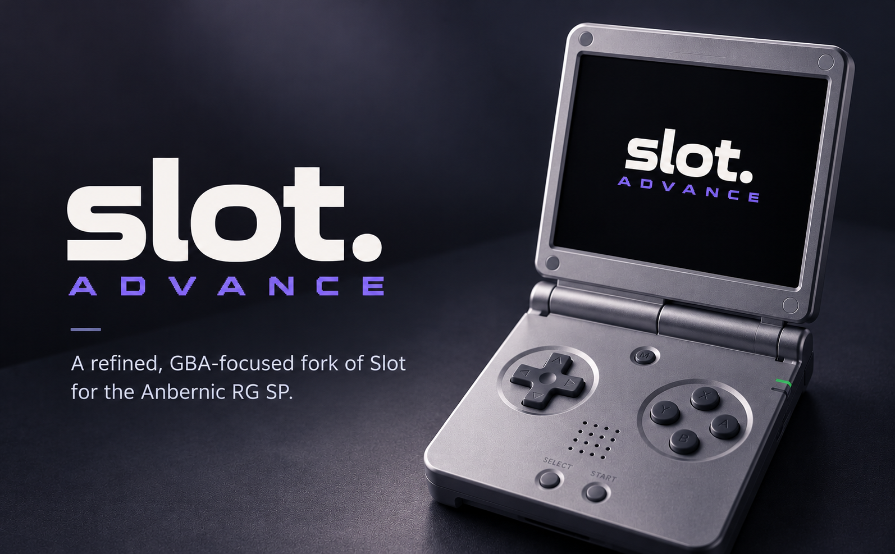
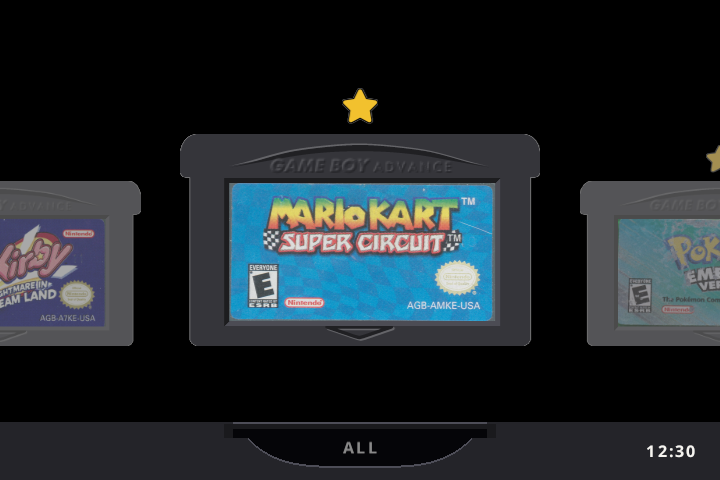
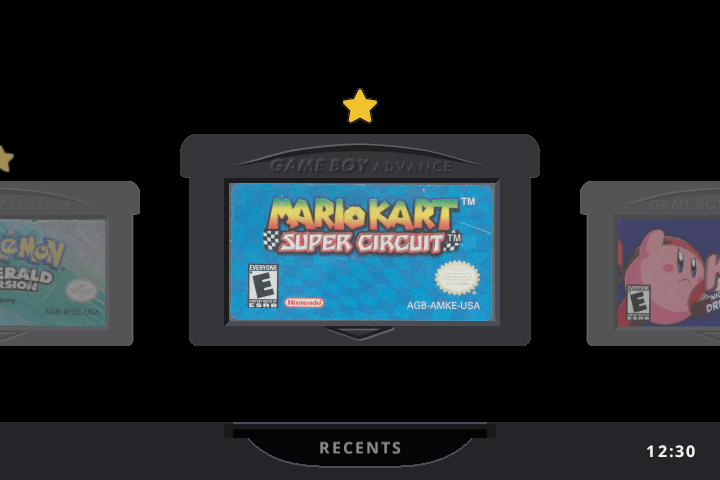
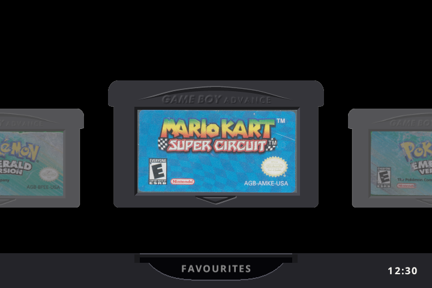
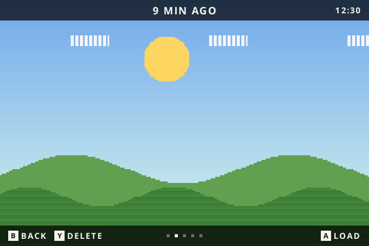
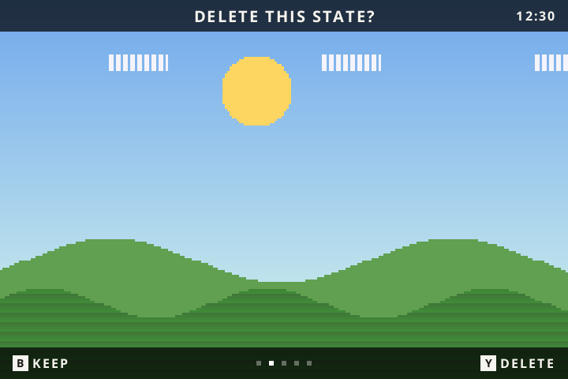

# slot advance

**A Game Boy Advance focused build of [slot](https://github.com/BrandonKowalski/slot) for the Anbernic RG SP.**

Favourites, recently played games and a tidier five-state save ring, on top of everything slot already does.

---

> [!NOTE]
> slot advance is a fork of **[slot](https://github.com/BrandonKowalski/slot)** by **Brandon T. Kowalski**. The carousel, the cart shelf, the save-state switcher, link play and nearly everything else you see is his work. This fork adds a few features for one particular way of playing: GBA games on a 720 x 480 RG SP. If you want the original, or support for other Anbernic devices, start with [slot](https://github.com/BrandonKowalski/slot).

# What's different

| | slot | slot advance |
|---|---|---|
| Categories | One shelf per platform | **All, Recents and Favourites**, switched with L2 / R2 |
| Favourites | None | **Y** stars a game; a gold star marks it on the shelf |
| Recently played | None | The last **10** games started, newest first |
| Manual save states | 10 per game | **5** per game, the oldest replaced by the newest |
| Save-state switcher | Left / Right | **Up / Down** as well |
| Deleting a state | Instant | **Asks first**: Y, then Y again |
| GBA screen shader | Grid by default | **Off** by default (GBA is an exact 3x on a 720 x 480 screen, so it is already pixel perfect) |
| Per-game settings | One setting for every game | **Each game remembers** its shader, colour correction, fast-forward speed and fast-forward sound |
| After a reboot | First cart on the shelf | **The game you played last**, in the category you started it from |
| Low battery | Shuts down at 5% | A quiet **banner at 15% and 10%** first, then the same 5% shutdown |
| Lid shut | Keeps drawing a black screen | **Stops drawing** while the lid is shut (still powers off after 3 minutes) |

Everything else works the way slot does, including the automatic suspend state when you close the lid, quick save and load, rewind, fast-forward, link play and the mGBA / gpSP core picker.

---

# What does it look like?

### All, with favourites starred

### Recents and Favourites

### The save-state switcher, and the delete question

Screenshots are rendered from slot advance's own drawing code at the RG SP's 720 x 480. The All, Recents and Favourites shelves use original cartridge-label artwork from the included starter pack. The switcher shows a stand-in scene instead of a game.

---

# Controls

Buttons side by side mean either one. A `+` means both together. **New** marks what this fork adds or changes.

### On the carousel

| Button | What it does | |
|---|---|---|
| `Left` / `Right` | Move along the shelf | |
| `Up` / `Down` | Skip to the next letter | |
| `L2` / `R2` | Switch category: All, Recents, Favourites (empty ones are skipped) | **New** |
| `Y` | Add or remove the game from Favourites | **New** |
| `L1` / `R1` | Same as `L2` / `R2` (and steps through GB and GBC shelves if you have those games too) | |
| Tap `A` | Resume where you left off | |
| Hold `A` | Start the game fresh | |
| `START` | Choose which emulator runs the cart (mGBA or gpSP) | |
| `MENU` | Settings | |

### In game

Shader, colour correction and fast-forward changes made in game are saved **for that game only**. Games you have never changed follow the defaults in the settings menu.

| Button | What it does | |
|---|---|---|
| `SELECT` + `R1` | Save a state (five per game, the sixth replaces the oldest) | **New** |
| `SELECT` + `L1` | Load the most recent saved state | |
| Double tap `MENU` | Open the save-state switcher | |
| Hold `MENU` | Save, eject the cart and go back to the carousel | |
| `SELECT` + `B` / `A` | Previous / next screen shader, named in a banner at the top | |
| `SELECT` + `Y` | Toggle colour correction | |
| `SELECT` + `L2` / `R2` | Slower / faster fast-forward (2x, 3x, 4x, 6x), for this game | **New** |
| `SELECT` + `X` | Fast-forward sound on / off, for this game | **New** |
| Hold `L2` | Rewind | |
| Hold `R2` | Fast-forward | |
| Double tap `R2` | Lock fast-forward on; press again to unlock | |
| Hold `X` / `Y` | Turbo A / Turbo B | |
| `SELECT` + `MENU` | Link with another device running slot | |
| Close the lid, or tap `POWER` | Save to the suspend slot and sleep. This never touches your five states | |

### In the save-state switcher

| Button | What it does | |
|---|---|---|
| `Up` / `Down` or `Left` / `Right` | Newer / older state | **New** |
| `A` | Load the state on screen. Nothing loads just by moving to it | |
| `B` or `MENU` | Back to the game | |
| `Y` | Delete: asks "Delete this state?" | **New** |
| `Y` again | Confirm the delete. Any other button keeps the state | **New** |
| `X` | Undo the last save or load, up to 30 seconds after | |

### Anywhere

| Button | What it does |
|---|---|
| `SELECT` + `Up` / `Down` | Brightness |
| `SELECT` + `Left` / `Right` | Blue light filter |
| `VOL+` / `VOL-` | Volume |
| `VOL+` + `VOL-`, or `SELECT` + a volume key | Mute |

---

# Installing

slot advance installs the same way as slot. Follow the [slot guide](https://slot-cfw.fyi) to set up both SD cards, then replace `System/slot` on the games card with the slot advance build.

> [!IMPORTANT]
> ROMs must be unzipped. slot does not read `.zip` or `.7z` files.

Ready-made downloads for this fork are coming soon.

### Where things are kept on the games card

| File or folder | What it holds |
|---|---|
| `Config/favourites.txt` | Your favourites, one per line, e.g. `GBA/Mother 3 (Japan)`. Safe to edit on a computer. |
| `Config/recents.txt` | Recently played games, newest first. |
| `Config/game_profiles.txt` | Each game's own shader, colour correction and fast-forward choices. Delete a game's lines to put it back on the defaults. |
| `States/GBA/<core>/<game>/` | Up to five save states, named by the time they were saved, plus `resume.state` for the lid and suspend. |
| `States/GBA/<core>/<game>/older/` | States moved out of the switcher when a game had more than five from an earlier version. Nothing is deleted. |
| `Saves/GBA/` | Battery saves (`.sav` / `.srm`), exactly as in slot. |

All three `.txt` files live in `Config/`, so replacing `System/` on an update leaves them alone.

---

# Credits

- **[slot](https://github.com/BrandonKowalski/slot)** by Brandon T. Kowalski: the frontend this fork is built on.
- **[ciscosweater/slots](https://github.com/ciscosweater/slots)**: the Recents category is adapted from this community fork, and its favourites tab inspired ours.
- **[mGBA](https://mgba.io)** by endrift and **[gpSP](https://github.com/libretro/gpsp)** through [libretro](https://www.libretro.com): the emulation.
- **[AGS-102](https://github.com/BrandonKowalski/AGS-102)**, a fork of [BaseOS](https://github.com/pvaibhav/BaseOS) by @pvaibhav: the operating system slot boots on.
- **[Open Sans](https://github.com/googlefonts/opensans)** (SIL Open Font License) and **[Nerd Fonts](https://www.nerdfonts.com)** symbols (MIT), including the favourite star.

slot advance is released under the same licence as slot, the [GNU GPL v3 or later](LICENSE).

---

# AI disclosure

slot's Rust frontend was put together with Claude Opus and reviewed by its author.

The changes in this fork were also written with Claude (Anthropic), at my direction, and checked with slot's own automated test suite plus new tests for each feature.
