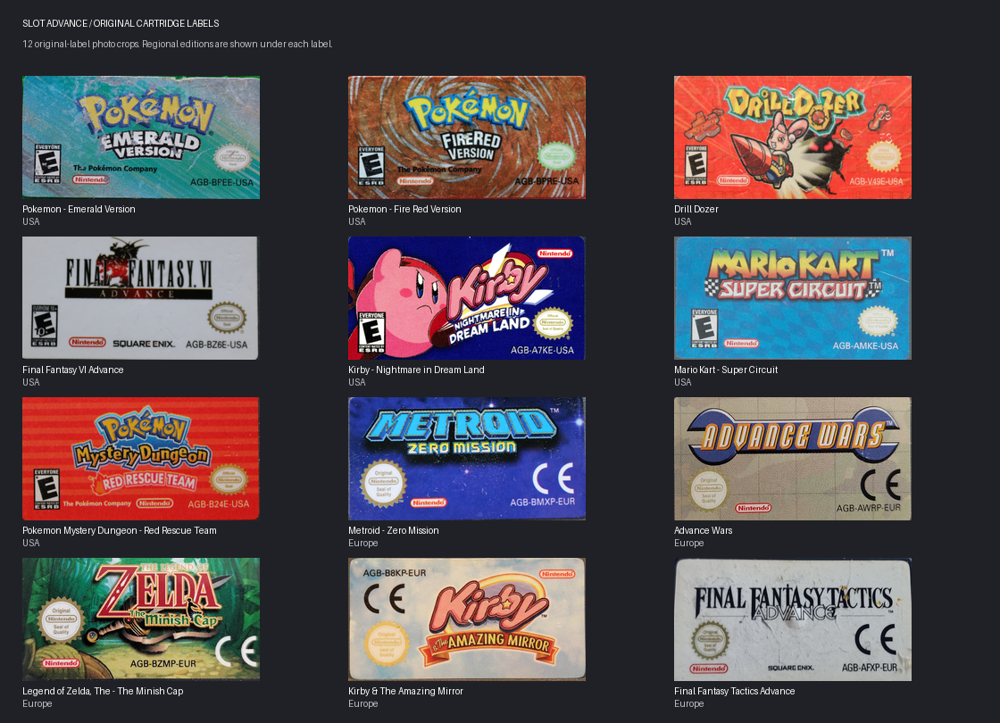

# Original GBA label starter pack

Twelve original cartridge-label photographs, cropped to the printed label and resized to 798 × 414 RGB PNG. Slot's current cartridge label panel is 266 × 138, so these files retain three times the display resolution and its exact aspect ratio. The frontend loads them using its existing label support; no rebuild is needed.



## Install

Copy the twelve game PNGs into `Labels/GBA/` on your Slot games card. Do not copy `preview.png` there. Each PNG filename must match the game filename exactly, apart from its extension. For example:

```text
Games/GBA/Mario Kart - Super Circuit (USA).gba
Labels/GBA/Mario Kart - Super Circuit (USA).png
```

The included filenames match the user's September 2026 inventory. If your current names differ, the optional installer matches the game title while ignoring region/revision tags and keeps existing artwork:

```sh
python3 scripts/install-labels.py /Volumes/YOUR_SLOT_CARD --dry-run
python3 scripts/install-labels.py /Volumes/YOUR_SLOT_CARD
```

Run these from the repository root. ROMs must already be unzipped in `Games/GBA`. The installer reports unsupported titles and leaves ROM files alone. It does not assign retail art to Emerald Seaglass, Unbound or explicitly marked hacks. It does not overwrite personal labels.

This is a starter set, not coverage of the entire game library. Golden Sun, Metroid Fusion and Mother 3 are not included yet.

## Regional editions and source credits

Some available photos show European labels even where the inventory contains a US ROM. The region below describes the **artwork**, not the ROM. The original printed art, ratings, language and signs of physical wear remain visible.

| Game | Artwork region | Photographer | Source |
|---|---|---|---|
| Pokémon Emerald | USA | Missingno_force | [Original photo entry](https://gbhwdb.gekkio.fi/cartridges/AGB-BPEE-0/missingno-force-1.html) |
| Pokémon FireRed | USA | Missingno_force | [Original photo entry](https://gbhwdb.gekkio.fi/cartridges/AGB-BPRE-1/missingno-force-1.html) |
| Drill Dozer | USA | 3615Retro | [Original photo entry](https://gbhwdb.gekkio.fi/cartridges/AGB-V49E-0/3615retro-1.html) |
| Final Fantasy VI Advance | USA | Missingno_force | [Original photo entry](https://gbhwdb.gekkio.fi/cartridges/AGB-BZ6E-0/missingno-force-1.html) |
| Kirby: Nightmare in Dream Land | USA | EchelonPrime | [Original photo entry](https://gbhwdb.gekkio.fi/cartridges/AGB-A7KE-0/echelonprime-1.html) |
| Mario Kart: Super Circuit | USA | FexCollects | [Original photo entry](https://gbhwdb.gekkio.fi/cartridges/AGB-AMKE-0/fexcollects-1.html) |
| Pokémon Mystery Dungeon: Red Rescue Team | USA | HDR | [Original photo entry](https://gbhwdb.gekkio.fi/cartridges/AGB-B24E-0/hdr-2.html) |
| Metroid: Zero Mission | Europe | Missingno_force | [Original photo entry](https://gbhwdb.gekkio.fi/cartridges/AGB-BMXP-0/missingno-force-1.html) |
| Advance Wars | Europe | ikk5 | [Original photo entry](https://gbhwdb.gekkio.fi/cartridges/AGB-AWRP-0/ikk5-1.html) |
| Zelda: The Minish Cap | Europe | ikk5 | [Original photo entry](https://gbhwdb.gekkio.fi/cartridges/AGB-BZMP-0/ikk5-1.html) |
| Kirby & the Amazing Mirror | Europe | 3615Retro | [Original photo entry](https://gbhwdb.gekkio.fi/cartridges/AGB-B8KP-0/3615retro-1.html) |
| Final Fantasy Tactics Advance | Europe | Granmastro | [Original photo entry](https://gbhwdb.gekkio.fi/cartridges/AGB-AFXP-0/granmastro-1.html) |

Photo credits: [Game Boy hardware database by Gekkio and contributors](https://gbhwdb.gekkio.fi/). The source photographs and these cropped adaptations are distributed under [CC BY-SA 4.0](https://creativecommons.org/licenses/by-sa/4.0/), separately from Slot's software licence. Changes are limited to cropping and resizing; game artwork and trademarks belong to their respective owners. Keep these credits with redistributed artwork.

`manifest.json` records the original photo URLs, crop coordinates, output filenames, regions and contributors for reproducibility.
