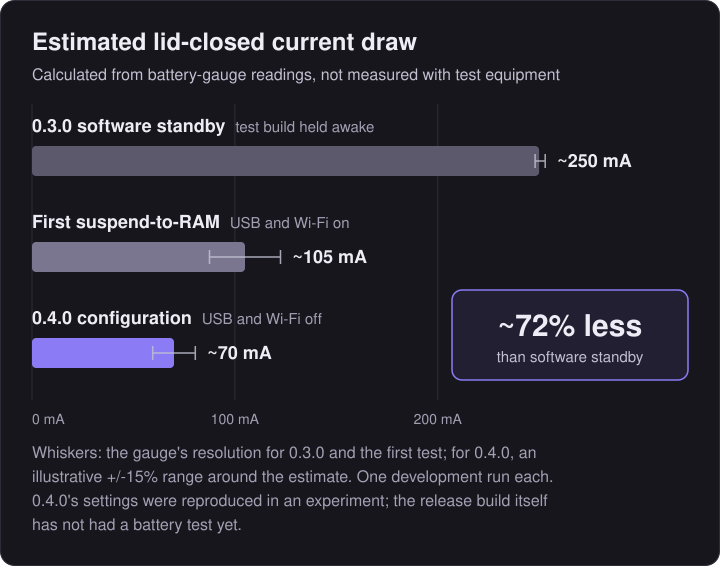
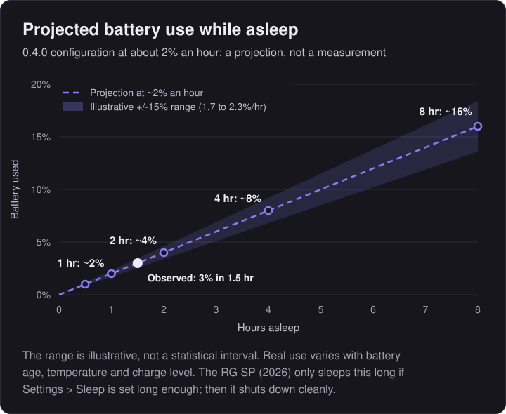

# Sleep and battery: how it works and how it was measured

This page is the detail behind the battery figures in the [README](../README.md). It covers how sleep has changed across slot.advance's releases, what 0.4.0 does when the lid closes, how the battery figures were obtained, how far they can be trusted, and what still has to be checked on the device.

Everything here applies to the **Anbernic RG SP (2026)** (720 x 480 screen) running BaseOS 1.3.0 (Linux 4.9). Version numbers are **slot.advance** versions, not upstream slot's. **0.4.0-beta.3** is the current recommended beta and is undergoing hardware validation; stable 0.4.0 will follow once the checks under [Validation status](#validation-status) pass. **0.3.0** (tag `advance-v3`) is the previous stable release.

## Contents

- [Summary](#summary)
- [The evolution of sleep](#the-evolution-of-sleep)
- [What 0.4.0 does when the lid closes](#what-040-does-when-the-lid-closes)
- [Battery results](#battery-results)
- [Methodology and uncertainty](#methodology-and-uncertainty)
- [Raw reports and calculations](#raw-reports-and-calculations)
- [Validation status](#validation-status)

---

## Summary

| Lid closed | Estimated current | Observed battery drop | Source |
|---|---|---|---|
| 0.3.0 software standby, test build held awake | ~250 mA (248 to 253) | 61% to 47% in 2 hours (~7% an hour) | Test B |
| First suspend-to-RAM, USB and Wi-Fi on | ~105 mA (87.5 to 122.5) | 68% to 62% in 2 hours (~3% an hour) | Test A |
| 0.4.0 configuration, USB and Wi-Fi off | ~70 mA (illustrative 60 to 80) | 77% to 74% in 1.5 hours (~2% an hour) | Experiment 5, segment 3 |

- All currents are **estimates calculated from the battery gauge**, not measured with electrical test equipment.
- **About 72% less** standby current: (250 - 70) / 250. Taking the 0.4.0 figure anywhere in 60 to 80 mA gives 68% to 76%.
- **The 0.4.0 figure comes from an experiment reproducing 0.4.0's settings**, not from a battery test of the integrated release build.
- **Ordinary 0.3.0 shuts down 3 minutes after the lid closes.** Its hourly figure describes a test build deliberately held in standby. A switched-off device draws only a negligible amount compared with any standby, so 0.4.0's benefit is staying asleep efficiently for hours with instant lid wake, not lower consumption than switching off.
- No change to battery use **during gameplay** has been measured, and none is claimed.

---

## The evolution of sleep

| | Upstream slot | slot.advance 0.3.0 | slot.advance 0.4.0 |
|---|---|---|---|
| CPU | Running | Running, mostly idle | Suspended |
| Drawing | A black frame every display refresh (~60 a second) | Two black frames, then none | None |
| Display | Backlight off | Backlight off | Suspended by its driver |
| Memory | Active | Active | Kept powered; the game is preserved |
| Unused USB host controllers and Wi-Fi | On | On | Off from startup |
| Emulator | Paused | Paused, no longer ticked | Paused, then frozen with the whole system |
| After the lid closes | Powers off after 3 minutes | Powers off after 3 minutes | Sleeps for the chosen time (3 min to 8 hr), then shuts down cleanly |
| Estimated lid-closed current | Not measured | ~250 mA (test build held awake) | ~70 mA (development configuration) |

**Upstream slot** (verified in its source, `crates/slot/src/device_app.rs` at the fork point): closing the lid turns off the backlight and pauses the game, but the main loop keeps running at the display's refresh rate (about 60 Hz). Each pass draws a full-screen black rectangle and swaps buffers. After 3 minutes it powers off, and the next boot restores the game from its suspend slot. Its standby current was never measured.

**slot.advance 0.3.0** (`crates/slot/src/standby.rs`): once the screen is dark, it draws two black frames and then stops drawing and stops ticking the emulator. It wakes every 50 ms to read input, poll the lid (every 150 ms) and run its timers. The CPU, memory and display hardware stay powered. Test B logged zero GPU interrupts a minute in this state, with the CPU governor at `performance`, 1.512 GHz. The 3-minute power-off is unchanged.

**slot.advance 0.4.0**: real Linux suspend-to-RAM, described next.

---

## What 0.4.0 does when the lid closes

1. **Save first.** The game's suspend slot (`resume.state`) and battery save are written and flushed to the card before anything else (`App::doze`). If the write fails, it is retried once. A game that still can't be saved is marked unsaved (see below).
2. **Settle.** Drawing stops as in 0.3.0. After a 400 ms pause, so a quick flick of the lid never reaches the kernel, slot.advance arms a wake alarm and suspends.
3. **Suspend to RAM.** slot.advance writes `mem` to `/sys/power/state` (`crates/slot-power/src/sleep.rs`). This is suspend-to-RAM, not the lighter `freeze` (suspend-to-idle). The kernel freezes all processes, suspends device drivers (the display among them), takes the secondary CPU cores offline and hands the last one to the platform firmware. Memory stays powered. Which power rails stay on is decided by the firmware, not Linux.
4. **Wake sources.**
   - **Lid:** the power chip's driver has an `os_sleep` setting. BaseOS writes `16` ("Super Standby") at every boot, in which the lid is not a wake source. slot.advance writes `0` ("Normal Standby") at startup, which makes the hall sensor a wake source through the power-key device. It refuses to suspend if the lid isn't armed.
   - **Timer:** the SoC's real-time clock (`sunxi-rtc`, found by name, never by number) with a relative alarm. The deadline is counted on the kernel's uptime clock, which keeps counting through suspend, so it always runs from the lid closing.
   - **`POWER`**, and incidental events from the power chip such as a charger.
5. **Classify every wake** (`crates/slot/src/sleep.rs`). Lid open: carry on playing, nothing reloaded. Deadline reached: shut down cleanly; the next boot restores the game from `resume.state`. Anything else (`POWER` with the lid shut, a charger, a stray event): back to sleep with the screen dark and the same deadline. More than 20 unexpected wakes in one sleep, or a suspend that fails twice, falls back to 0.3.0's software standby for that sleep.

**Unused hardware** (`crates/slot-power/src/quiet.rs`). At startup, slot.advance switches off the six USB host controllers `ohci1-3` and `ehci1-3` through their sysfs switches. The RG SP (2026)'s USB-C port uses a separate controller (`5100000.udc`, with `ehci0`/`ohci0`) and is not touched. Once BaseOS has finished starting Wi-Fi (uptime 20 s), slot.advance unloads the `8821cs` driver, which cuts the radio's supply rail, unless `wifi=on` is set. Both are logged and optional, hardware sleep never depends on either, and both last only until the next boot. They stay off during gameplay too; no gameplay battery effect has been measured.

**Battery cap.** Sleep is planned to aim to preserve approximately 10% of the battery. It assumes a deliberately pessimistic 100 mA, so the device wakes and shuts down early if the chosen time would go below about 10%. This is a plan based on the gauge, not a guarantee. At 10% or less it sleeps for 3 minutes, as 0.3.0 did. The 5% shutdown from slot still applies.

**Save safety.** A game that could not be written when the lid closed is never shut down by the timer. Instead, the device keeps sleeping and retries the save at each deadline, and only the 5% battery shutdown can end it. This now includes the case where the emulator core fails to provide its state. Before commit `dbbadae`, that case was wrongly reported as saved. A core that is still loading, or failed to start, has no progress to lose and is treated as saved.

### The lid-wake trade-off

Experiment 5 compared the same hardware with lid wake armed (Normal Standby, segment 3, ~70 mA) and with the firmware's deeper Super Standby (segment 4, ~64 mA, lid not armed). Lid wake costs roughly 7 to 9 mA, about 10%. slot.advance keeps it, because waking by opening the lid is the point of sleeping instead of switching off.

---

## Battery results

<p align="center">

</p>

<sub>Bars are estimates calculated from battery-gauge readings. Whiskers show the gauge's resolution for 0.3.0 (tick-timed) and the first suspend test, and an illustrative ±15% range for 0.4.0. One development run per configuration.</sub>

### Projected battery use while asleep

<p align="center">

</p>

<sub>A projection at ~2% an hour. Only the white point (3% over 1.5 hours) was observed. The shaded band is an illustrative ±15%, explained below. Real use varies with battery age, temperature and charge level.</sub>

| Asleep for | Projected battery used | Illustrative range |
|---|---|---|
| 30 min | ~1% | 0.8 to 1.1% |
| 1 hr | ~2% | 1.7 to 2.3% |
| 2 hr | ~4% | 3.4 to 4.6% |
| 4 hr | ~8% | 6.8 to 9.2% |
| 8 hr | ~16% | 13.6 to 18.4% |

The longest single sleep tested so far lasted 2 hours (Test A). Nothing longer has been run in the 0.4.0 configuration.

---

## Methodology and uncertainty

**Instrument.** The only measurement available on the device is the battery gauge. Its `charge_counter` is just the battery percentage multiplied by the 3,500 mAh design capacity: every reading is a multiple of 35,000 µAh. So the real resolution is one percent, **35 mAh**.

**Test B (0.3.0 software standby).** This used a test build of 0.3.0 whose only change was a 3-hour standby timeout instead of 3 minutes, so standby could be held for 2 hours. With the lid closed, a logger recorded the gauge every minute. From the start and end readings alone, the figure is 245 ± 17.5 mA. Because each 1% tick can be timed to within a minute, the 13 full steps between the first and last tick pin it down to **248 to 253 mA**. The ticks came every 7 to 9 minutes throughout, so the drain was steady.

**Test A (first suspend-to-RAM).** One `mem` suspend lasted 2 hours, with lid wake armed and USB and Wi-Fi on. The device was awake for only 2.35 s of the 7,201 s interval. The battery fell from 68% to 62%. Each end reading could be anywhere within its 1% band, so the result is **105 ± 17.5 mA**. *The raw report prints ±2.5 mA. That assumed 5 mAh steps, before Test B showed the step is 35 mAh, and it is wrong.*

**Experiment 5 (where the current goes).** This was one overnight run of four 90-minute suspends, each adding one change. Each segment ran from one 1% tick to the first tick after waking. The device then stayed awake until the next tick, to measure its awake current for the time it spent awake inside the segment.

| Segment | Configuration | Battery while asleep | Raw estimate (35 mAh steps) | Assuming 240 / 250 / 260 mA awake |
|---|---|---|---|---|
| 1 | Normal Standby, lid armed, USB and Wi-Fi on | 89% to 84% | 130.9 mA | 94 / 98 / 102 mA |
| 2 | + USB host controllers off | 82% to 79% | 77.2 mA | 66 / 69 / 71 mA |
| 3 | + Wi-Fi off (**the 0.4.0 configuration**) | 77% to 74% | 69.8 mA | 70 / 73 / 75 mA |
| 4 | Super Standby, lid not armed | 72% to 70% | 62.6 mA | 61 / 64 / 66 mA |

**The gauge isn't linear at high charge.** Above about 80%, one percent step worked out to about 26 mAh instead of 35. That is why segment 1's raw figure, 131 mA, is far above Test A's 105 mA for the same configuration. The right-hand column sidesteps step size: within a segment, the asleep and awake readings come from the same part of the gauge, so their ratio doesn't depend on the step. That ratio is then scaled by an assumed awake current (Test B measured 250 mA). Below 80%, the raw and corrected figures agree. Segment 3, at 77% to 73%, gives 69.8 mA raw and 70 to 75 mA corrected. *The raw report's ±0.5 mA figures ignore this effect and are too optimistic.*

**What the comparisons support.**
- The two runs of the baseline configuration agree within their uncertainty: Test A at 105 ± 17.5 mA, and segment 1 at about 98 mA corrected.
- USB off (segment 1 to 2) gave the largest single saving, roughly 30 mA. This rests on one run, and its exact size is mixed up with the high-charge gauge error.
- Wi-Fi off showed no saving that could be separated from noise while asleep.
- The direction of the overall improvement is confirmed by two independent comparisons (Test A against segment 3, and segment 1 against segments 2 and 3). The size, about 105 to about 70 mA, rests on single runs.

**The illustrative range.** The 0.4.0 estimate is drawn with a ±15% band: 60 to 80 mA, or 1.7 to 2.3% an hour. **It is not a statistical confidence interval.** It was chosen to cover the spread of the segment 3 calculations (69.6 to 75.4 mA across the awake-current assumptions) and the variation in gauge step size seen below 80% (35 to 36.4 mAh), with some margin, because the configuration was run only once. The observed drop, 3 whole percent in 1.5 hours, is consistent with anything from 1.3 to 2.7% an hour.

---

## Raw reports and calculations

| File | What it is |
|---|---|
| [`battery-tests/test-b-software-standby.txt`](battery-tests/test-b-software-standby.txt) | Test B, 10 October 2026 (UTC): 0.3.0 software standby held awake for 2 hours, with the minute-by-minute log |
| [`battery-tests/test-a-suspend-usb-wifi-on.txt`](battery-tests/test-a-suspend-usb-wifi-on.txt) | Test A, 10 October 2026 (UTC): one 2-hour `mem` suspend with lid wake, USB and Wi-Fi on |
| [`battery-tests/experiment-5-suspend-segments.txt`](battery-tests/experiment-5-suspend-segments.txt) | Experiment 5, 11 October 2026 (UTC): four 90-minute suspends, with USB, Wi-Fi and PE19 states logged around every sleep |
| [`battery-tests/calculate.py`](battery-tests/calculate.py) | Recalculates every figure on this page from the three reports |
| [`battery-tests/charts.py`](battery-tests/charts.py) | Regenerates the three battery charts |

The reports are unedited device output. Their own summary lines contain the two errors noted above (Test A's ±2.5 mA and Experiment 5's ±0.5 mA). `calculate.py` shows the corrected working. Run it from the repository root:

```
python3 documentation/battery-tests/calculate.py
```

The earlier experiments that established suspend, lid wake, timed wake and `POWER` wake on the RG SP (2026), Experiments 1 to 4, are not included here; they took no battery measurements.

---

## Validation status

**Shown on the RG SP (2026) with development scripts, before 0.4.0 was built:**
- `mem` suspend: about 15 cycles across Experiments 2 to 5 and Test A, with no failures.
- Lid wake, with the screen back in under a second, from the carousel.
- Timed wake accurate to 1 to 2 seconds, over sleeps of 30 seconds to 2 hours, with no unexpected wakes during long sleeps.
- The USB controllers and Wi-Fi stay off through suspend and resume.
- The SD card reads and writes straight after resume.
- `POWER` wake with the lid shut (Experiment 4). The device woke early as expected, but the script could not confirm the cause from its interrupt counts.

**Shown on the device with 0.4.0-beta.1 (`slot.log`, 12 October 2026):**
- Sleep and resume from inside a running game: five sleeps of 13 seconds to 27 minutes, each resuming straight into the game, with sound reported normal.
- A timed shutdown: with Sleep at `3 min`, the device woke at 179 seconds and shut down cleanly, and the next session loaded the game at boot.
- Rapid lid flicks: the kernel's refusals to suspend mid-flick were handled, but after some flicks the screen stayed dark for 4 to 5 seconds with the lid open. The lid driver had recorded "shut" after the wake. 0.4.0-beta.3 checks the sensor's raw level in that case (see `crates/slot-power/src/lid.rs`).

**Still to verify before 0.4.0 is released as stable:**
- Rapid lid flicks on 0.4.0-beta.3: the screen should come back as soon as the lid opens. `slot.log` notes each time the sensor overrules the driver.
- Connecting and disconnecting the charger while asleep.
- Rumble, headphones and all controls after many sleeps.
- A fresh battery measurement of the release build. This is desirable but not required: until it exists, the figures above stay labelled as preliminary.

Until those checks pass, 0.4.0 stays a beta (currently **0.4.0-beta.3**, the recommended download). Stable 0.4.0 will follow successful testing.
